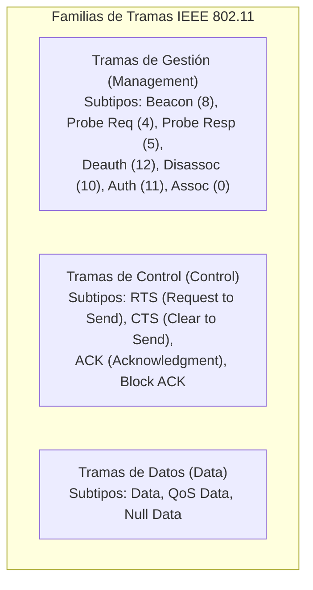

# Plan de Estudio y Guía de Auditoría de Redes Inalámbricas (Wi-Fi / 802.11)
### Preparación Certificación OSWP (Offensive Security Wireless Professional) y Pentesting RF

Este documento es una guía metodológica y formativa completa para auditar, evaluar y defender infraestructuras de red inalámbricas basadas en el estándar **IEEE 802.11 (Wi-Fi)**. Centraliza y complementa todo el material técnico, scripts, capturas `.pcap` y evidencias prácticas alojadas en la carpeta [`Wireless_Pentesting/`](file:///home/diego-romero/Documents/oscpRepo/Wireless_Pentesting).

---

## Índice
1. [Requisitos de Hardware y Entorno del Kernel Linux](#1-requisitos-de-hardware-y-entorno-del-kernel-linux)
2. [Arquitectura y Fundamentos de la Capa de Enlace RF (802.11)](#2-arquitectura-y-fundamentos-de-la-capa-de-enlace-rf-80211)
3. [Plan de Estudio por Niveles: Subiendo los Voltios en Wireless](#3-plan-de-estudio-por-niveles-subiendo-los-voltios-en-wireless)
   - [Nivel W1: Reconocimiento y Sniffing Pasivo del Espectro](#nivel-w1-reconocimiento-y-sniffing-pasivo-del-espectro-voltaje-bajo-)
   - [Nivel W2: Redes Abiertas y WEP (Cifrado Legacy)](#nivel-w2-redes-abiertas-y-wep-cifrado-legacy-voltaje-medio-)
   - [Nivel W3: WPA / WPA2-Personal (Handshake y PMKID)](#nivel-w3-wpa--wpa2-personal-handshake-y-pmkid-voltaje-alto-)
   - [Nivel W4: Protección de Tramas de Gestión (802.11w / PMF) y WPA3](#nivel-w4-protección-de-tramas-de-gestión-80211w--pmf-y-wpa3-voltaje-muy-alto-)
   - [Nivel W5: Redes Corporativas WPA/WPA2-Enterprise (802.1X / RADIUS)](#nivel-w5-redes-corporativas-wpawpa2-enterprise-8021x--radius-voltaje-máximo-)
   - [Nivel W6: Rogue APs, Evil Twin y Portales Cautivos](#nivel-w6-rogue-aps-evil-twin-y-portales-cautivos-voltaje-especial-)
4. [Arsenal de Herramientas y Scripts del Repositorio (`Wireless_Pentesting/`)](#4-arsenal-de-herramientas-y-scripts-del-repositorio-wireless_pentesting)
5. [Estructura del Informe Técnico de Auditoría Inalámbrica](#5-estructura-del-informe-técnico-de-auditoría-inalámbrica)

---

## 1. Requisitos de Hardware y Entorno del Kernel Linux

Las auditorías de redes inalámbricas exigen interacción directa con las capas inferiores de radiofrecuencia (RF), lo cual depende estrictamente del chipset de la tarjeta de red Wi-Fi y su controlador en Linux:

### Chipsets Homologados para Auditoría e Inyección de Paquetes
| Chipset | Banda RF | Driver Linux (`mac80211`) | Estándares | Notas de Operación |
| :--- | :---: | :---: | :---: | :--- |
| **Ralink RT3070 / RT3072** | 2.4 GHz | `rt2800usb` | 802.11 b/g/n | El estándar clásico (Alfa AWUS036NEH / AWUS036NH). Gran estabilidad en inyección. |
| **Atheros AR9271** | 2.4 GHz | `ath9k_htc` | 802.11 b/g/n | Firmware 100% libre. Soporte nativo perfecto en cualquier kernel Linux sin compilar. |
| **MediaTek MT7612U** | 2.4 / 5 GHz | `mt76x2u` | 802.11 a/b/g/n/ac | Doble banda moderna con soporte integrado directamente en el kernel oficial de Linux. |
| **Realtek RTL8812AU / RTL8814AU** | 2.4 / 5 GHz | `8812au` / `8814au` (DKMS) | 802.11 a/b/g/n/ac | Alta potencia doble banda (Alfa AWUS036ACH). Requiere compilar módulo DKMS. |

### Configuración del Entorno de Auditoría
```bash
# 1. Identificación física del adaptador USB
lsusb
# 2. Identificación lógica de interfaces Wi-Fi
iw dev
# 3. Detener procesos conflictivos del gestor de red (NetworkManager, wpa_supplicant)
sudo airmon-ng check kill
# 4. Habilitar Modo Monitor manual en la interfaz
sudo ip link set wlx00c0ca97bdaa down
sudo iw dev wlx00c0ca97bdaa set type monitor
sudo ip link set wlx00c0ca97bdaa up
# 5. Comprobación de capacidad de inyección de paquetes
sudo aireplay-ng --test wlx00c0ca97bdaa
```

---

## 2. Arquitectura y Fundamentos de la Capa de Enlace RF (802.11)

A diferencia de Ethernet (802.3), donde el medio físico está confinado por un cable, en 802.11 el medio es el aire compartido. Las tramas se clasifican en tres grandes familias:



### Cabecera de Direccionamiento 802.11 (4 Direcciones MAC)
Una trama Wi-Fi puede contener hasta cuatro direcciones MAC según la dirección del tráfico:
1. **Address 1 (RA - Receiver Address):** Dirección física de la estación o AP que recibe la trama por RF.
2. **Address 2 (TA - Transmitter Address):** Dirección física que transmite la trama en el canal de radio.
3. **Address 3 (DA o BSSID):** Dirección del destinatario final o identificación de la red inalámbrica.
4. **Address 4 (SA):** Dirección del emisor original (utilizado únicamente en redes Wireless Distribution System / WDS / Mesh).

---

## 3. Plan de Estudio por Niveles: Subiendo los Voltios en Wireless


---

### Nivel W1: Reconocimiento y Sniffing Pasivo del Espectro (Voltaje Bajo 🟡)
**Objetivo:** Mapear el entorno radioeléctrico, identificar redes ocultas, canales operativos, clientes conectados y capacidades criptográficas sin transmitir un solo paquete.

1. **Barrido de Redes con `airodump-ng`:**
   ```bash
   sudo airodump-ng --band abg wlx00c0ca97bdaa
   ```
2. **Focalización Dirigida a un BSSID y Canal Específico:**
   ```bash
   sudo airodump-ng -c 1 --bssid 84:D3:43:51:32:18 -w /tmp/captura_canal1 wlx00c0ca97bdaa
   ```
3. **Disección de Tramas Beacon con `tshark` / Wireshark:**
   * Filtrar tramas Beacon (`wlan.fc.type_subtype == 8`).
   * Inspección de Information Elements (IE): SSID, Supported Rates, RSN Information (Cifrado WPA2/WPA3), Vendor Specific (WPS / Fabricante).
   * Script del repositorio: [`analizar_beacon.py`](file:///home/diego-romero/Documents/oscpRepo/Wireless_Pentesting/analizar_beacon.py).

---

### Nivel W2: Redes Abiertas y WEP (Cifrado Legacy) (Voltaje Medio 🟠)
**Objetivo:** Comprender las debilidades criptográficas históricas del algoritmo RC4 y los ataques matemáticos de correlación de claves (requerido en OSWP).

1. **Causa Raíz:** Clave secreta concatenada con un Vector de Inicialización (IV) de solo 24 bits. El espacio de IVs (16.7 millones) se satura rápidamente y genera colisiones (Key Scheduling Algorithm / KSA defectuoso).
2. **Metodología de Inyección ARP para forzar generación de IVs:**
   ```bash
   # Paso 1: Autenticación falsa con el AP
   sudo aireplay-ng -1 0 -a <BSSID> -h <MI_MAC> wlx00c0ca97bdaa
   # Paso 2: Replay de peticiones ARP capturadas
   sudo aireplay-ng -3 -b <BSSID> -h <MI_MAC> wlx00c0ca97bdaa
   ```
3. **Ataques de Recuperación de Clave:**
   * **FMS (Fluhrer, Mantin, Shamir):** Requiere ~500,000 IVs.
   * **KoreK:** Ataques estadísticos optimizados.
   * **PTW (Pyshkin, Tews, Weinmann):** Requiere tan solo de 40,000 a 85,000 tramas de datos para descifrar la clave WEP de 128 bits en menos de 60 segundos con `aircrack-ng`.

---

### Nivel W3: WPA / WPA2-Personal (Handshake y PMKID) (Voltaje Alto 🔴)
**Objetivo:** Capturar y auditar la autenticación pre-compartida (PSK) en redes domésticas y de pequeñas oficinas.

#### 1. Captura del 4-Way Handshake (EAPOL)
* **Mecanismo:** La clave maestra `PMK = PBKDF2(Passphrase, SSID, 4096, 256)` no viaja por el aire. El cliente y el AP intercambian números aleatorios (`ANonce`, `SNonce`) en 4 tramas EAPOL para derivar la clave temporal `PTK`.
* **Ataque de Desautenticación Activa:** Forzar a un cliente conectado a reasociarse para interceptar las tramas 1, 2, 3 y 4:
  ```bash
  sudo aireplay-ng -0 5 -a <BSSID> -c <MAC_CLIENTE> wlx00c0ca97bdaa
  ```
  *(O mediante el script Scapy del repositorio: [`prueba_deauth.py`](file:///home/diego-romero/Documents/oscpRepo/Wireless_Pentesting/prueba_deauth.py))*.

#### 2. Ataque Moderno Sin Clientes: Captura de PMKID (Clientless Attack)
* **Descubrimiento:** Publicado por Jens Steube (Hashcat), no requiere clientes conectados en la red.
* **Mecanismo:** El AP envía el identificador de clave maestra `PMKID` en la primera trama EAPOL de asociación dentro del Information Element RSN:
  $$\text{PMKID} = \text{HMAC-SHA1-128}(\text{PMK}, \text{"PMK Name"} \parallel \text{MAC}_{\text{AP}} \parallel \text{MAC}_{\text{STA}})$$
* **Herramientas:** Captura con `hcxdumptool` y conversión a formato Hashcat:
  ```bash
  hcxdumptool -i wlx00c0ca97bdaa -o pmkid.pcapng --enable_status=1
  hcxpcapngtool -o hash.22000 -E essidlist pmkid.pcapng
  ```

#### 3. Auditoría de Contraseñas Offline:
```bash
# Con Aircrack-ng:
aircrack-ng -w /usr/share/wordlists/rockyou.txt captura.cap
# Con Hashcat (Modo 22000 WPA-PBKDF2-PMKID/EAPOL acelerado por GPU):
hashcat -m 22000 hash.22000 /usr/share/wordlists/rockyou.txt
```

---

### Nivel W4: Protección de Tramas de Gestión (802.11w / PMF) y WPA3 (Voltaje Muy Alto ⚡)
**Objetivo:** Auditar la resiliencia de la red frente a ataques de denegación de servicio (DoS) y forzado de desconexión.

1. **Funcionamiento de IEEE 802.11w (PMF):**
   * En WPA2 tradicional, las tramas de desautenticación son en texto claro. Cualquier tercero puede falsificar la MAC del AP y desconectar clientes.
   * Con **PMF activado**, las tramas de gestión unicast van cifradas con la clave de sesión (CCMP/TKIP), y las tramas broadcast llevan una firma criptográfica **BIP (Broadcast Integrity Protocol)** basada en AES-CMAC.
2. **Inspección de Capacidades RSN (MFPC / MFPR):**
   * **MFPC (Capable):** El AP soporta tramas protegidas si el cliente lo solicita.
   * **MFPR (Required):** El AP **exige** obligatoriamente protección de tramas de gestión; descarta cualquier cliente que no soporte 802.11w.
   * Script de diagnóstico del repositorio: [`audit_vector1_pmf.sh`](file:///home/diego-romero/Documents/oscpRepo/Wireless_Pentesting/audit_vector1_pmf.sh).
3. **Evolución a WPA3-Personal:**
   * Sustituye la clave PSK por el protocolo de intercambio de claves **SAE (Simultaneous Authentication of Equals / Dragonfly)**.
   * Inmune a ataques de diccionario offline mediante captura de handshakes pasivos. Requiere ataques activos o aprovechamiento de canales laterales (*Dragonblood*).

---

### Nivel W5: Redes Corporativas WPA/WPA2-Enterprise (802.1X / RADIUS) (Voltaje Máximo 🔥)
**Objetivo:** Auditar entornos corporativos con autenticación centralizada por usuario y contraseña.

1. **Arquitectura 802.1X:**
   * **Supplicant (Cliente):** Dispositivo del empleado que solicita acceso.
   * **Authenticator (Punto de Acceso):** Controla el puerto virtual y retransmite credenciales.
   * **Authentication Server (RADIUS):** Servidor centralizado (FreeRADIUS, Microsoft NPS, Cisco ISE).
2. **Protocolos EAP Principales:**
   * **PEAP-MSCHAPv2:** Muy extendido en empresas. Si el cliente no valida el certificado SSL del servidor, es vulnerable a ataques de *Rogue AP*.
   * **EAP-TLS:** Máxima seguridad mediante certificados digitales mutuos (cliente y servidor). Inmune a captura de credenciales por diccionario.
3. **Ataque Evil Twin Corporativo con `hostapd-mana` / `eaphammer`:**
   * Levantar un punto de acceso falso con el mismo SSID corporativo.
   * Cuando una estación corporativa intenta autenticarse mediante PEAP sin verificar certificado, el falso servidor RADIUS captura el hash **MSCHAPv2 / NetNTLM**.
   * Descifrado de contraseñas de dominio Active Directory con `asleap` o Hashcat (modo 5500).

---

### Nivel W6: Rogue APs, Evil Twin y Portales Cautivos (Voltaje Especial 🌐)
**Objetivo:** Evaluar la vulnerabilidad del factor humano y dispositivos IoT frente a redes clonadas.

1. **Ataque de Gemelo Malvado (Evil Twin):**
   * Clonar BSSID, ESSID y canal de una red legítima con mayor potencia de transmisión (dBm).
   * Desautenticar a los clientes de la red real para forzarlos a conectarse al AP atacante.
2. **Despliegue de Portal Cautivo Clonado:**
   * Configurar servidor DHCP local (`dnsmasq`) y redirección DNS total hacia un servidor web atacante.
   * Servir una réplica exacta de la página de actualización del router, inicio de sesión corporativo o portal de hotel para capturar la contraseña ingresada por el usuario.
   * Herramientas de automatización: Airgeddon, Wifiphisher, Fluxion.

---

## 4. Arsenal de Herramientas y Scripts del Repositorio (`Wireless_Pentesting/`)

El repositorio incluye un conjunto de herramientas artesanales listas para producción:

| Archivo / Script | Lenguaje | Función Técnica |
| :--- | :---: | :--- |
| [`setup_monitor.sh`](file:///home/diego-romero/Documents/oscpRepo/Wireless_Pentesting/setup_monitor.sh) | Bash | Detiene procesos conflictivos del sistema y activa el modo monitor con validación en `sysfs`. |
| [`restore_managed.sh`](file:///home/diego-romero/Documents/oscpRepo/Wireless_Pentesting/restore_managed.sh) | Bash | Restablece la interfaz a modo Managed y reactiva NetworkManager. |
| [`test_injection.sh`](file:///home/diego-romero/Documents/oscpRepo/Wireless_Pentesting/test_injection.sh) | Bash | Prueba de inyección de paquetes en canal específico con `aireplay-ng --test`. |
| [`analizar_beacon.py`](file:///home/diego-romero/Documents/oscpRepo/Wireless_Pentesting/analizar_beacon.py) | Python (Scapy) | Disección forense de tramas Beacon, extracción de RSN IE, Vendor OUI y fingerprinting de router. |
| [`audit_vector1_pmf.sh`](file:///home/diego-romero/Documents/oscpRepo/Wireless_Pentesting/audit_vector1_pmf.sh) | Bash / Tshark | Auditoría automatizada de los bits `MFPC` y `MFPR` en el Information Element RSN para validar 802.11w. |
| [`prueba_deauth.py`](file:///home/diego-romero/Documents/oscpRepo/Wireless_Pentesting/prueba_deauth.py) | Python (Scapy) | Generación forjada de tramas de desautenticación capa 2 (Subtipo 12) dirigidas por dirección MAC. |
| **Archivos PCAP de Referencia** | `.pcap` | Muestras de tráfico forense real capturadas: `beacon.pcap`, `honor_prueba_deauth.pcap`, `honor_desconexion_base.pcap`, `honor_prueba_activa.pcap`. |

---

## 5. Estructura del Informe Técnico de Auditoría Inalámbrica

Para documentar auditorías Wi-Fi profesionales con estándar de entrega empresarial y de certificación OSWP, utiliza la plantilla consolidada en [`Wireless_Pentesting/informe_auditoria_inalambrica.md`](file:///home/diego-romero/Documents/oscpRepo/Wireless_Pentesting/informe_auditoria_inalambrica.md):

1. **Resumen Ejecutivo y Alcance:** Metadatos, SSID, BSSID, canales de prueba y hardware utilizado.
2. **Metodología de Pruebas:** Pruebas pasivas (análisis espectral) vs. activas (inyección y desautenticación).
3. **Matriz de Vulnerabilidades:** Evaluación de PMF, debilidad de clave PSK, aislamiento de clientes (*Client Isolation*) y cifrados obsoletos (TKIP/WEP).
4. **Evidencias Gráficas y Forenses:** Capturas de pantalla de terminal y diagramas de secuencia de tramas.
5. **Plan de Remediación y Hardening:** Configuración recomendada para controladores inalámbricos (WPA3-SAE, 802.11w Required, WIDS, segmentación VLAN).
